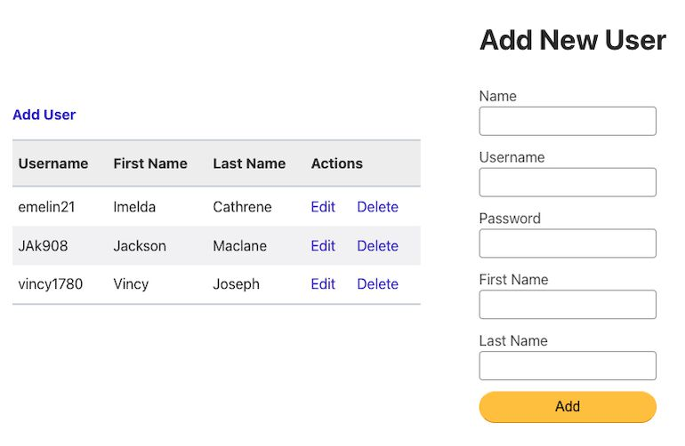
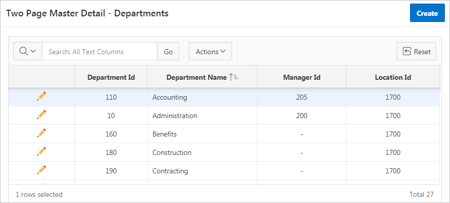
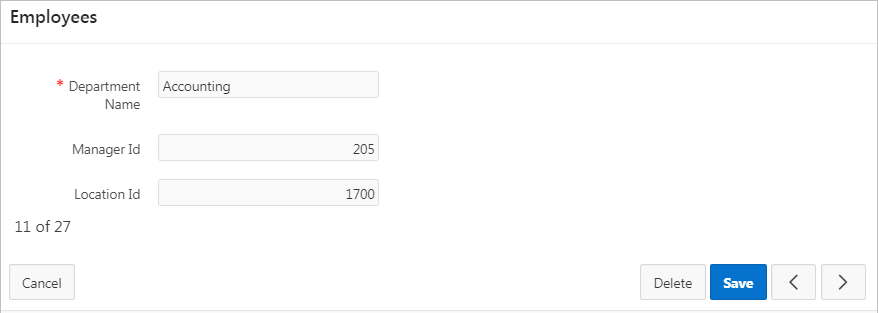

# Resumen del enunciado del 2do parcial

## Descripción general

* El software a desarrollar es una especie de editor para dibujar interfaces de usuario, algo como Figma.
    * El usuario crea, diseña, interfaces de usuario (formularios tipo CRUD) en el software.
    * Estas interfaces deben estar enlazadas, es decir, deben ser navegables.
* El software debe permitir generar el código de una aplicación móvil Flutter a partir de los diseños realizados.

## Desafío

* El software debe ser **colaborativo**:
    * Es decir, debe permitir que dos o más ingenieros de software diseñen una misma interfaz al mismo tiempo.
    * Alguien define una sesión en el software (por ejemplo, creando un enlace) y otros se conectan a la sesión definida abriendo dicho enlace. 
        * Como se hace en Google Documents, Trello o Figma, donde varios usuarios pueden editar un mismo documento/tablero/diseño al mismo tiempo de manera colaborativa.
* El software debe **aplicar IA** para interpretar bocetos:
    * El usuario le saca una foto a un boceto.
        * Se llama _boceto_ a un dibujo de una interfaz de usuario hecha a mano, por ejemplo, sobre una servilleta de papel.
    * El usuario sube esta foto al software.
    * La IA interpreta el boceto en la foto y crea un diseño equivalente en el software que estamos desarrollando.
    * Luego, el usuario puede continuar editando dicho diseño en el software que estamos desarrollando.
* El software debe **aplicar IA** para generar un diseño de interfaces de usuario a partir de un prompt.
    * Este prompt debe ser independiente de la IA utilizada.
    * Un ejemplo de prompt podría ser: _"Diseñar un software ecommerce que haga esto... que tenga esto..."_

## Sobre las tecnologías a utilizar

* Proceso de desarrollo usando Scrum.
* Usar C4 para modelar la arquitectura del software, usando modelos de contexto, de contenedores y de componentes.
* Usar UML (versión 2.5 o posterior) para modelar todo lo demás.

## Sobre las interfaces de usuario

* Las interfaces de usuario que el software permitirá diseñar son formularios
  como los que se utilizan en los sistemas de información.
    * Estos formularios utilizan componentes (llamados Widgets en Flutter) para ingresar texto, botones para ejecutar acciones, casillas de verificación (checkbox), listas desplegables (combobox), etc.
* Estos formularios tienen acciones predecibles (CRUD = create, read, update, delete).
* Los campos de estos formularios son como los atributos
  en una clase: tienen nombre de atributo, tipos de dato, visibilidad, relación con otro formulario, etc.
* Las interfaces de usuario diseñadas son formularios conocidos como _detail forms_.
* El código generado incluye los _detail forms_ + sus respectivos formularios _index_, o _master form_.
    * Cada formulario _master form_ muestra todos los registros que pueden modificarse mediante su respectivo _detail form_.
    * **Ejemplo 1.** La siguiente imagen muestra un ejemplo de formulario _master form_ (al lado izquierdo) junto a su formulario _detail form_ (al lado derecho) para agregar un nuevo usuario:
    
    * **Ejemplo 2.** En la sección _Two Page Master Detail_ de 
    <a href="https://docs.oracle.com/database/apex-18.1/HTMDB/managing-master-detail-forms.htm#HTMDB30059" target="_blank">Managing Master Detail Forms</a>
    se puede encontrar un ejemplo de cómo se desea que sean los 
    formularios generados mediante el software que se va a desarrollar en este Parcial. 
    _Ejemplo de master form_:
    
    _Ejemplo de detail form_:
    

* Las interfaces generadas también deben almacenar localmente 
  los datos ingresados como una forma de probar que son funcionales.

## Sobre el código generado

* El software debe generar automáticamente como mínimo un 95% del código de la aplicación móvil Flutter.
* Esto quiere decir que como máximo un 5% del código:
    * Será agregado manualmente por el usuario. 
    * Y este código será el necesario para que la aplicación generada pueda ejecutarse normalmente como una aplicación Flutter.
* El software debe entregar al usuario el código generado comprimido en un archivo .zip.
* El usuario descarga este archivo .zip, lo descomprime, lo abre en Visual Studio Code y después de  realizar unos pocos ajustes, lo ejecuta como una aplicación móvil Flutter.
* Se puede usar un archivo .bat para facilitar al usuario la ejecución de la aplicación Flutter generada.
