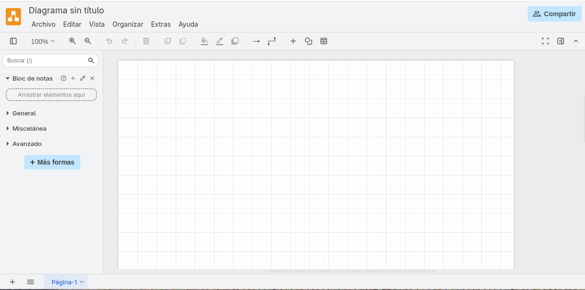
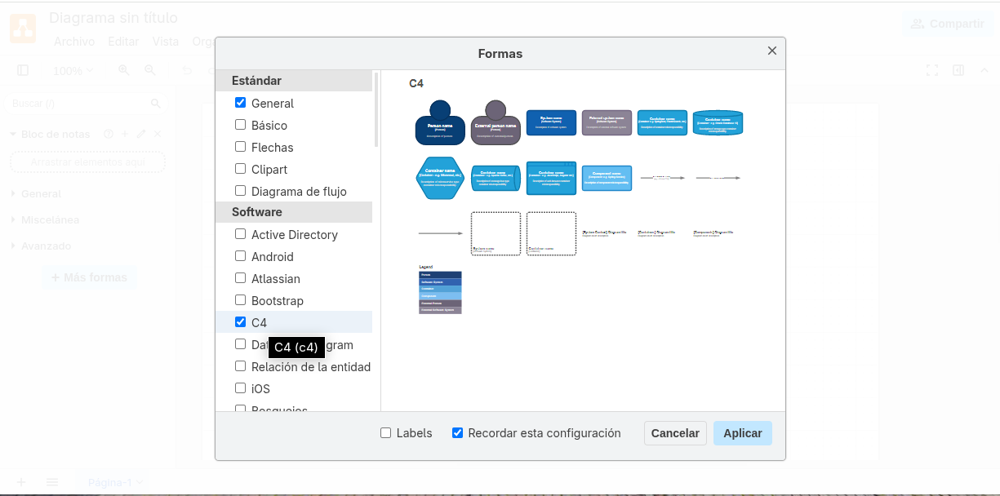
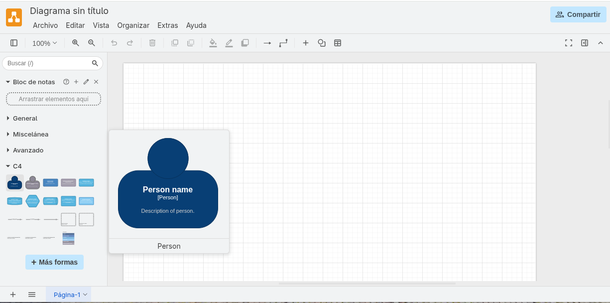
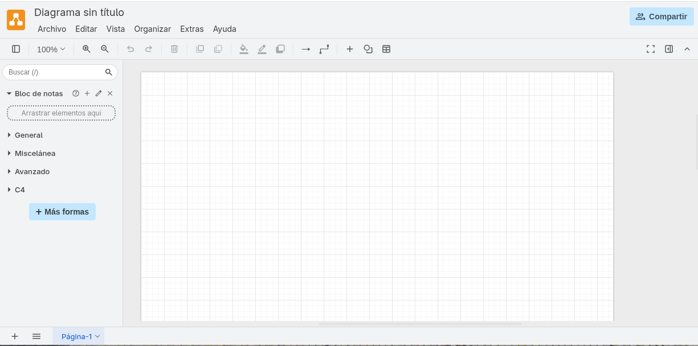
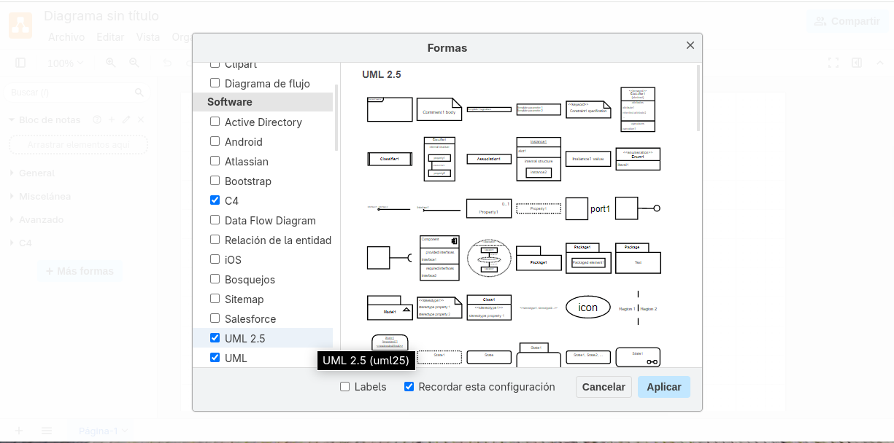
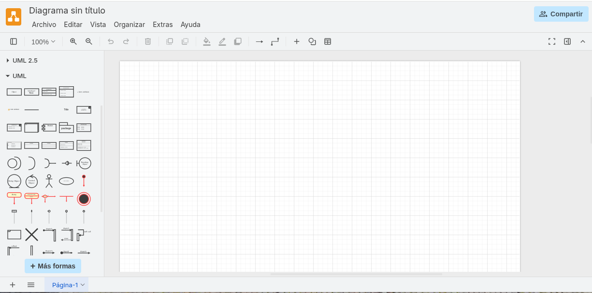
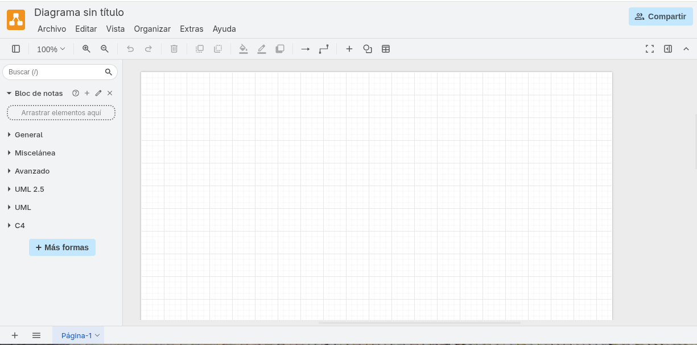
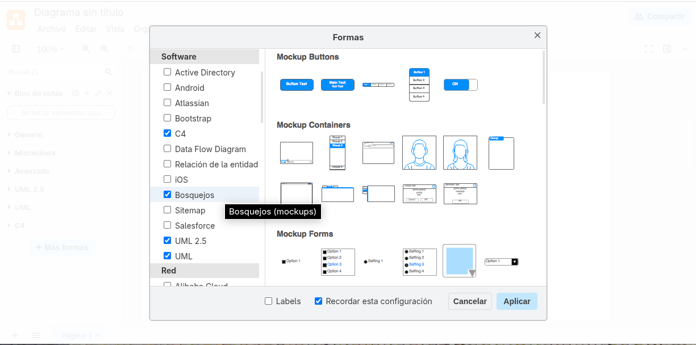
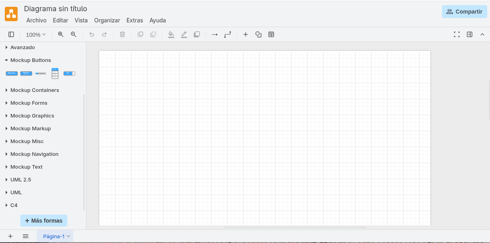

# draw.io

<a href="https://www.drawio.com/about" target="_blank">draw.io</a>
es un software
que permite realizar modelos UML, C4 y también prototipos de interfaz de usuario.

Para utilizar draw.io abrir el siguiente enlace:

<a href="https://app.diagrams.net/" target="_blank">https://app.diagrams.net/</a>

## Para realizar modelos C4

Para realizar modelos C4 usando draw.io, primero se deben agregar
las formas (o elementos) de C4. Para ello, seguir los siguientes pasos.

Hacer clic en el botón "+ Más formas" que se encuentra
en el lado izquierdo de la ventana de draw.io:

Luego, en el cuadro de diálogo que aparece,
en la sección "Software", marcar la opción que dice "C4"
y hacer clic en el botón "Aplicar", como se muestra en la siguiente imagen:

Ahora, se puede observar que en el lado izquierdo de la ventana de draw.io
aparece la sección "C4" que contiene los elementos necesarios
para realizar modelos C4:

## Para realizar modelos UML

Para realizar modelos UML 2.5 usando draw.io, primero se deben agregar
las formas (o elementos) de UML 2.5. Para ello, seguir los siguientes pasos.

Hacer clic en el botón "+ Más formas" que se encuentra
en el lado izquierdo de la ventana de draw.io:

Luego, en el cuadro de diálogo que aparece,
en la sección "Software", marcar la opción que dice "UML 2.5" y también
marcar la opción que dice "UML". Y hacer clic en el botón "Aplicar":

Ahora, se puede observar que en el lado izquierdo de la ventana de draw.io
aparecen las secciones "UML 2.5" y "UML" que contienen los elementos necesarios
para realizar modelos UML 2.5:

## Para realizar prototipos

Para realizar prototipos de interfaz de usuario usando draw.io, primero se deben agregar
las formas o elementos necesarios. Para ello, seguir los siguientes pasos.

Hacer clic en el botón "+ Más formas" que se encuentra
en el lado izquierdo de la ventana de draw.io:

Luego, en el cuadro de diálogo que aparece,
en la sección "Software", marcar la opción que dice "Bosquejos"
y hacer clic en el botón "Aplicar":

Ahora, se puede observar que en el lado izquierdo de la ventana de draw.io
aparecen varias secciones llamadas "Mockup...", como "Mockup Buttons",
que contienen los elementos necesarios para realizar prototipos de interfaz de usuario
de aplicaciones de escritorio, móviles y web:

