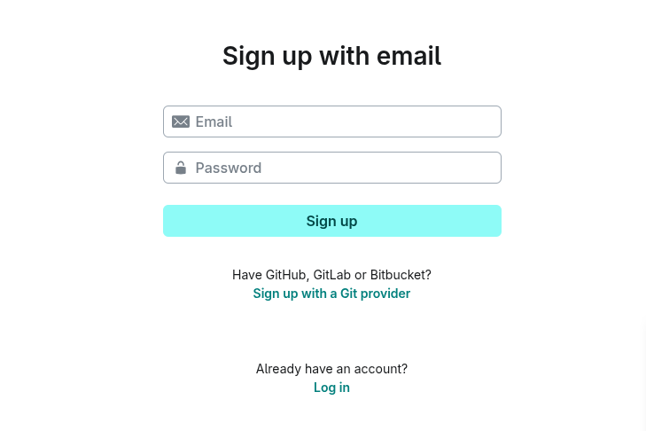
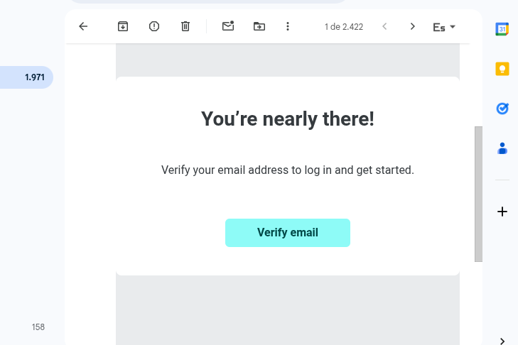
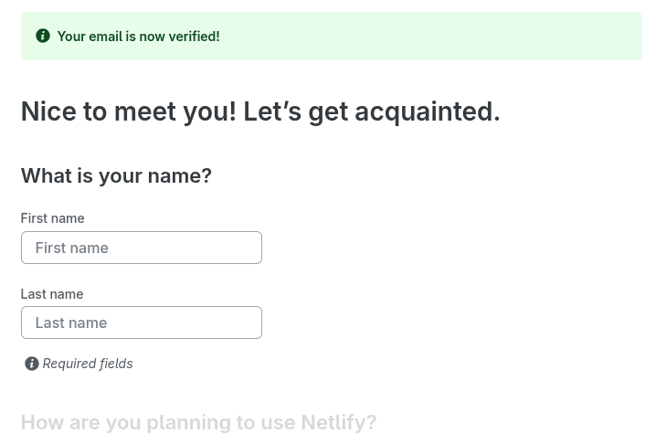
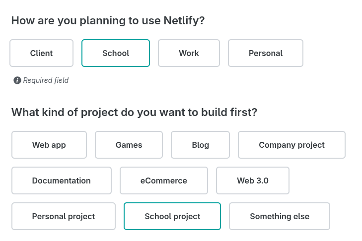
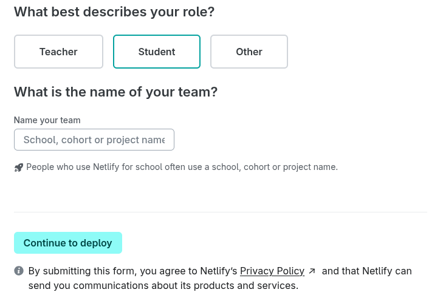
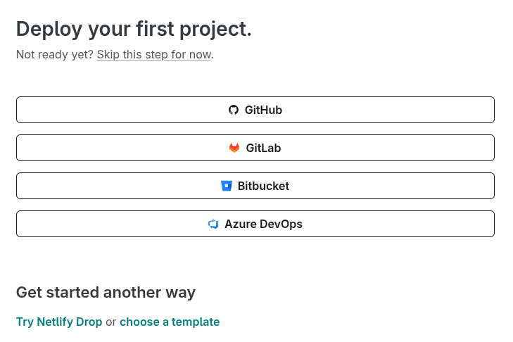

# Para crear una cuenta en Netlify

Para crear una cuenta en Netlify, abrir el siguiente enlace:

<a href="https://app.netlify.com/signup/email" target="_blank">https://app.netlify.com/signup/email</a>

Ingresar los datos solicitados y hacer clic en el botón "Sign up":

Abrir el email recibido desde Netlify (en la cuenta de correo ingresada en el paso anterior).
Y hacer clic en el botón "Verify email":

Luego, en la página que se abre, ingresar los datos solicitados por Netlify:

Al terminar de ingresar los datos solicitados,
hacer clic en el botón "Continue to deploy":

En este punto, la creación de la cuenta ha terminado y se puede cerrar la página que aparece:

Continue [instalando la herramienta llamada Netlify CLI](./instalar-netlify-cli/)
para poder realizar el despliegue del frontend.

