# Para desplegar el frontend

Para desplegar el frontend en Netlify, seguir los siguientes pasos.

## Inicializar un proyecto de Netlify

Abrir en Visual Studio Code el proyecto inicial del frontend que se generó en la sección ["Para generar el proyecto inicial del frontend"](../../frontend/toolpad/) (en este ejemplo, dicho proyecto se llama "beingafriend"):

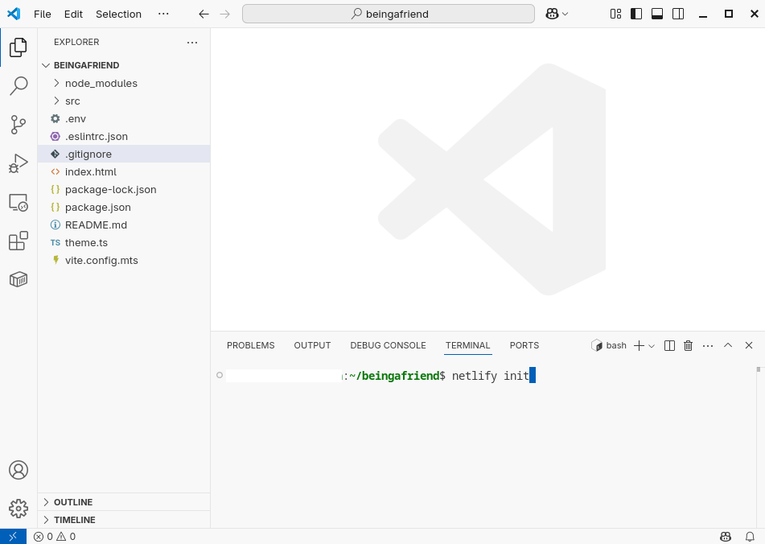

Y, como se muestra en la imagen de arriba, 
abrir una terminal presionando CTRL+J, y
ejectuar el siguiente comando:

```bash
netlify init
```

Elegir la opción "Yes, create and deploy project manually", usando las teclas de flecha,
y presionar ENTER:
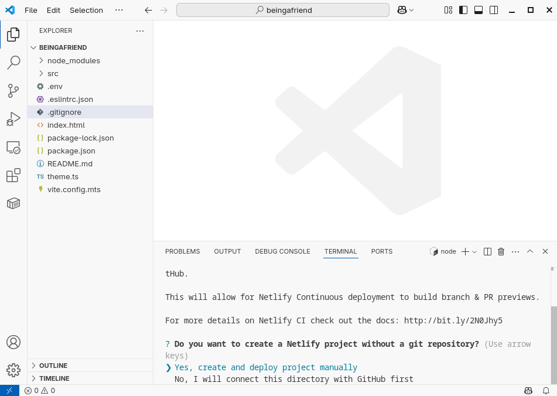

Seleccionar un "Team" y presionar ENTER:
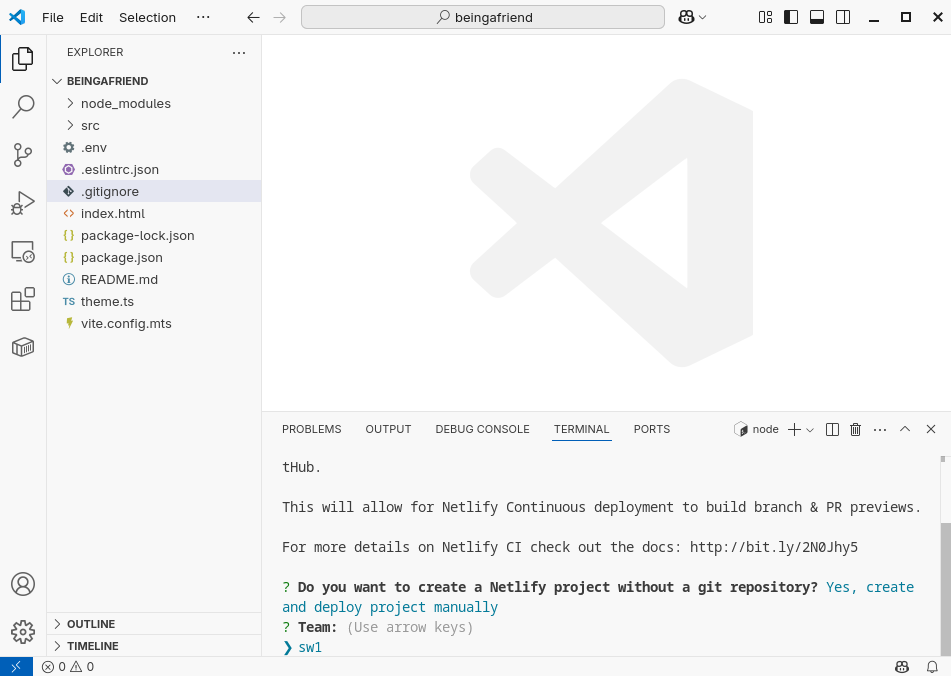

Ingresar el nombre del proyecto que se está inicializando
(en este ejemplo, el proyecto se llama "beingafriend"):
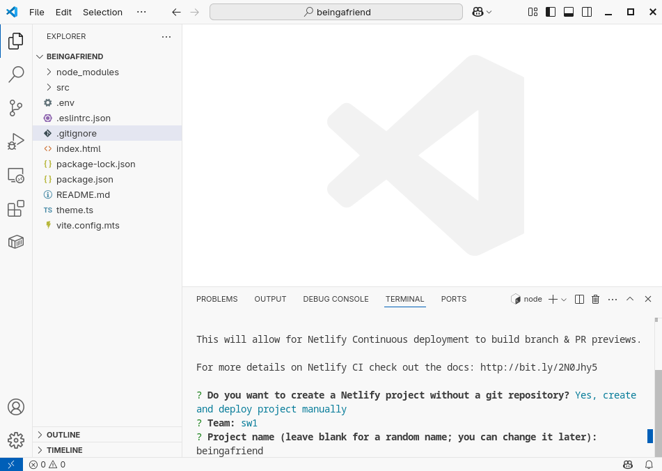

Ingresar "Y" y presionar ENTER, como se muestra en la siguiente imagen:
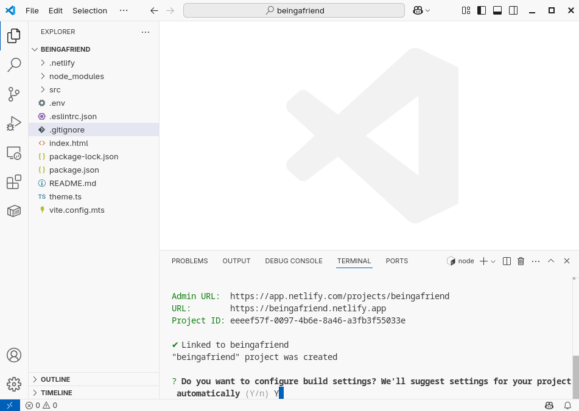

Ingresar "vite build" y presionar ENTER, como se muestra en la siguiente imagen:
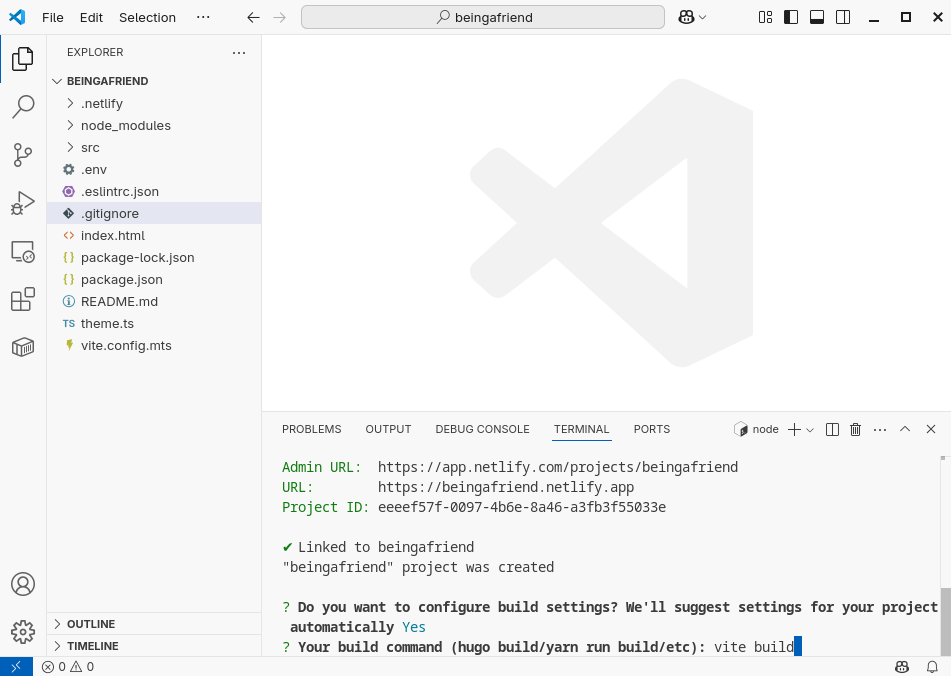

Ingresar "dist" y presionar ENTER, como se muestra en la siguiente imagen:
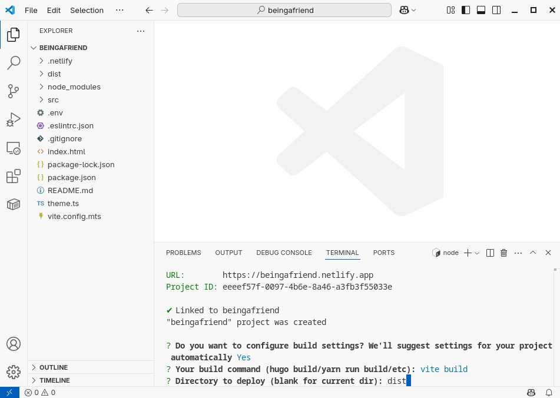

Ingresar "Y" y presionar ENTER, como se muestra en la siguiente imagen:
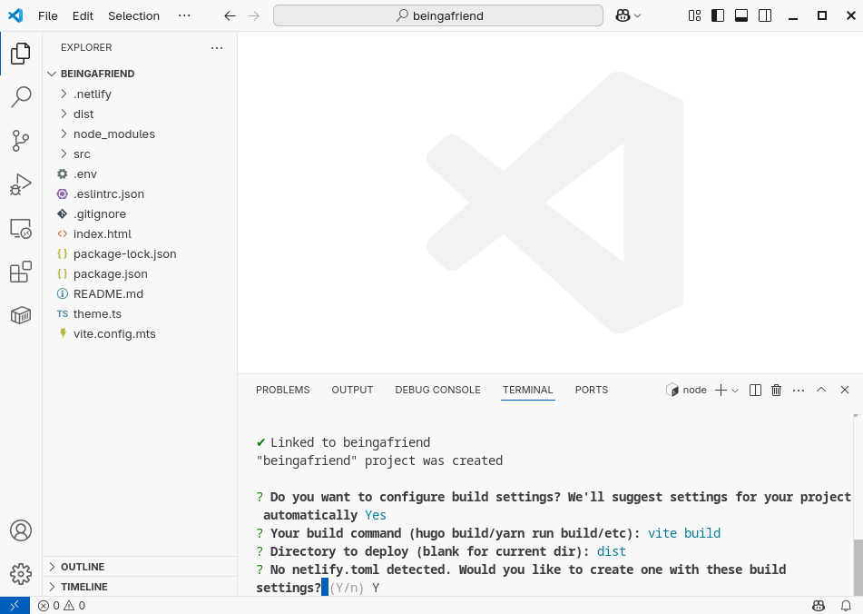

¡Felicidades! 🥳🎉 acaba de inicializar su proyecto inicial del frontend para poder desplegarlo con Netlify.

## Ejecutar localmente el frontend

En adelante, para ejecutar localmente el proyecto inicial del frontend se recomienda ejecutar el siguiente comando:

```bash
netlify dev
```

De esta forma, la herramienta `netlify` configura localmente un entorno de ejecución para el frontend similar al entorno en el que se ejecutará el frontend al ser desplegado en la nube.

## Desplegar el frontend

Finalmente, para desplegar el frontend en la nube, ejecutar el comando `netlify deploy`,
como se muestra en la siguiente imagen:
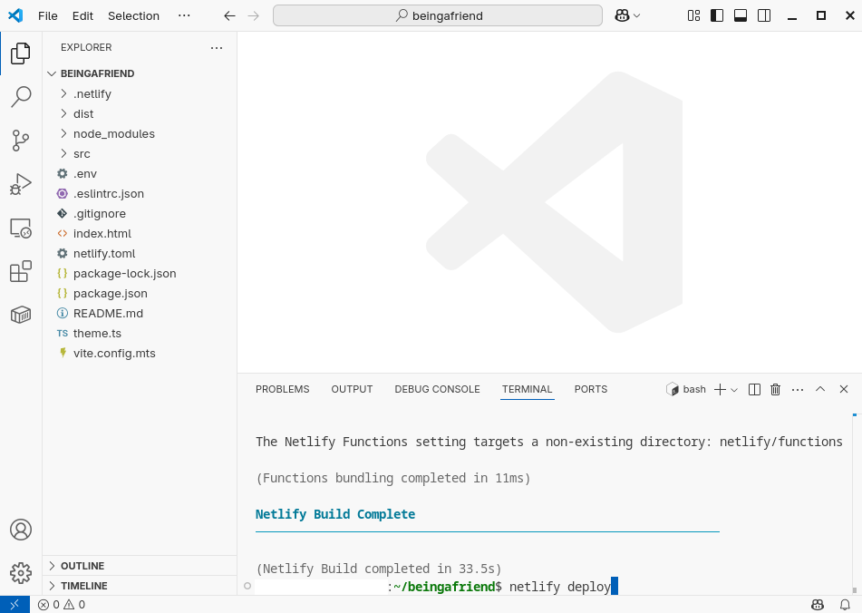

Al finalizar el despligue del proyecto, 
verá su propia URL en la terminal
(en este ejemplo dicha URL es: 
<a href="https://683f8ffe6acded4c5d444ae9--beingafriend.netlify.app" target="_blank">
https://683f8ffe6acded4c5d444ae9--beingafriend.netlify.app
</a>),
como se muestra en la siguiente imagen:
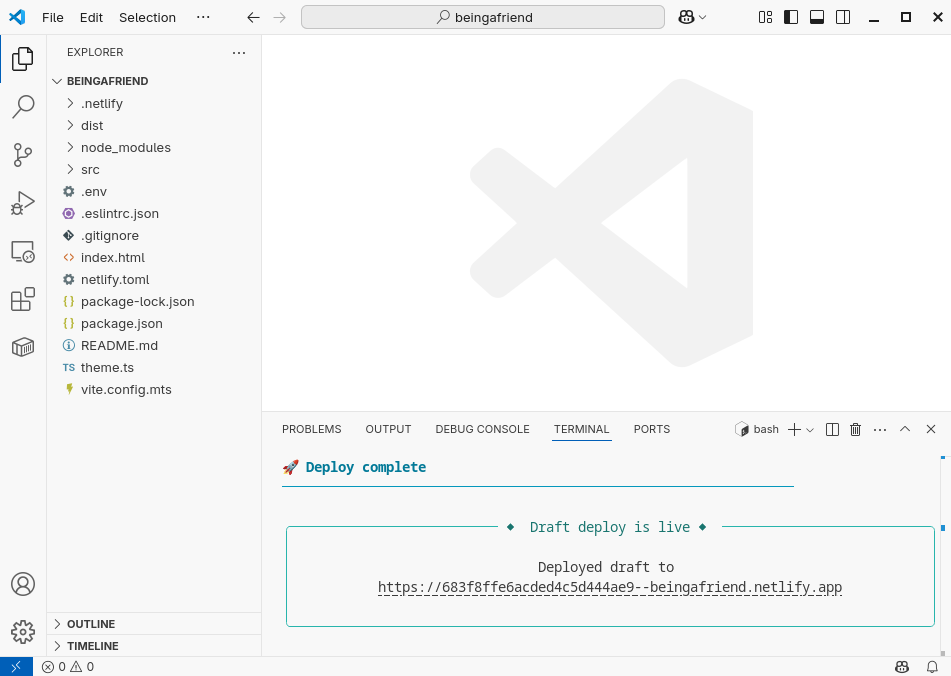

Al abrir dicha URL (<a href="https://683f8ffe6acded4c5d444ae9--beingafriend.netlify.app" target="_blank">
https://683f8ffe6acded4c5d444ae9--beingafriend.netlify.app
</a>) e iniciar sesión,
se puede ver que el frontend ha sido desplegado correctamente en la nube:
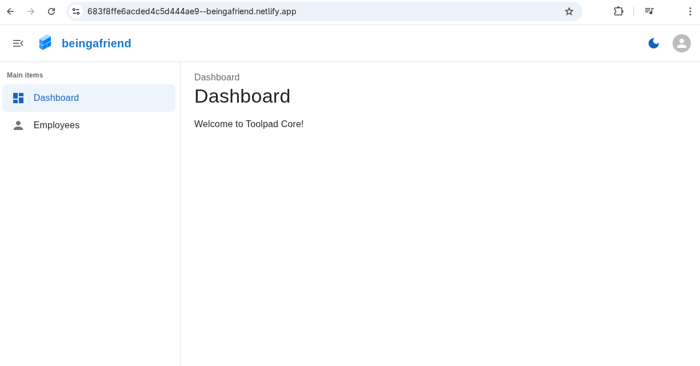

¡Felicidades! 🥳🎉 ha desplegado correctamente su proyecto inicial del frontend en la nube.

## Desplegar el frontend en producción

Para desplegar el frontend en producción, es decir, para la presentación final,
ejecutar el comando:

```bash
netlify deploy --prod
``` 

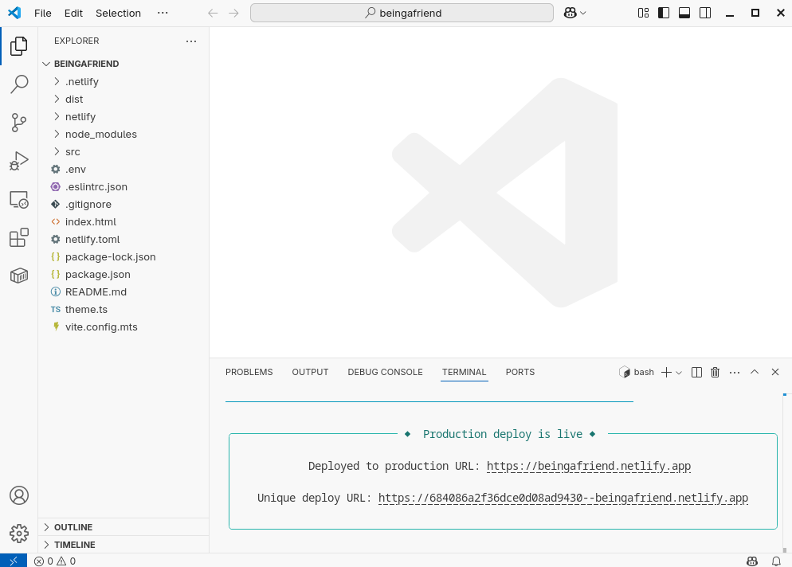

Como se ve en la imagen de arriba, 
después de ejecutar `netlify deploy --prod`,
la salida de la terminal muestra la URL de producción 
("Deployed production URL") del proyecto.
En este ejemplo esta URL es:

<a href="https://beingafriend.netlify.app" target="_blank">
https://beingafriend.netlify.app
</a>

Para su proyecto esta URL será la que vea en su terminal.

¡Felicidades! 🥳🎉 ha desplegado en producción su proyecto inicial de frontend en la nube.

A continuación, se muestra la tecnología que se puede aplicar para [implementar el backend](../implementar-el-backend/).
