# Para implementar el backend

Para implementar el backend se puede aplicar la tecnología 
llamada _funciones sin servidor_
(<i><a href="https://docs.netlify.com/functions/overview/" target="_blank">serverless functions</a></i>)
de Netlify.

Las funciones sin servidor son como las funciones 
que normalmente se escriben en JavaScript o TypeScript.
Con la diferencia de que se pueden llamar de manera remota,
como consumiendo un endpoint de API REST.

Usando las funciones sin servidor
se puede implementar casi toda la lógica o procesos del backend
del 2do Parcial.

Por ejemplo, se puede implementar
el proceso de traducir un boceto a un diseño que se pueda editar en el software,
llamando a la 
<a href="https://ai.google.dev/gemini-api/docs/quickstart?hl=es-419#javascript" target="_blank">
API de Gemini 
</a>
dentro de una función sin servidor que recibe
en uno de sus parámetros la foto que contiene dicho boceto
y devuelve como resultado el diseño equivalente, obtenido mediante IA.

Sin embargo, para aplicar adecuadamente 
las funciones sin servidor es necesario conocer los límites de este tipo de funciones.

## Límites de las funciones sin servidor

Las funciones sin servidor de Netlify tienen los siguientes 
<a href="https://docs.netlify.com/functions/overview/#default-deployment-options" target="_blank">límites</a>
:

* 1024 MB de memoria RAM
* Límite de ejecución de 30 segundos para funciones síncronas, incluidas las programadas
* Límite de ejecución de 15 minutos para funciones en segundo plano
* Límite de tamaño de carga útil de solicitud y respuesta de 6 MB para funciones síncronas con búfer
* Límite efectivo inferior para cargas útiles de solicitudes binarias.
    * Las solicitudes con cargas útiles binarias, como la carga de imágenes,
    se codifican en Base64.
    Esta codificación supone una sobrecarga 
    de aproximadamente el 30% en relación con el tamaño de los datos binarios originales, 
    lo que reduce eficazmente el límite de tamaño de la carga útil de la solicitud binaria a 4,5 MB.

* Límite de tamaño de carga útil de respuesta de 20 MB para funciones síncronas transmitidas (_streamed_)
* Límite de tamaño de carga útil de solicitud y respuesta de 256 KB para funciones en segundo plano

Fuente: <a href="https://docs.netlify.com/functions/overview/#default-deployment-options" target="_blank">
https://docs.netlify.com/functions/overview/#default-deployment-options
</a>

En resumen, las funciones sin servidor deben devolver una respuesta
en menos de 30 segundos y sólo pueden recibir datos binarios (fotos)
que tengan un tamaño máximo de aproximadamente 4,5 MB.

## Para crear una función sin servidor

Para crear una función sin servidor, 
primero abrir en Visual Studio Code 
el proyecto inicial del frontend que se creó en la sección 
["Para generar el proyecto inicial del frontend"](/tecnología/para-la-implementación/frontend/toolpad/).

Luego, abrir una terminal presionando CTRL+J.
Y seguir los siguientes pasos.

Ejecutar el siguiente comando 
para crear una función sin servidor llamada "ejemplo-funcion"

```bash
netlify functions:create --name ejemplo-funcion
```
como se muestra en la siguiente imagen:
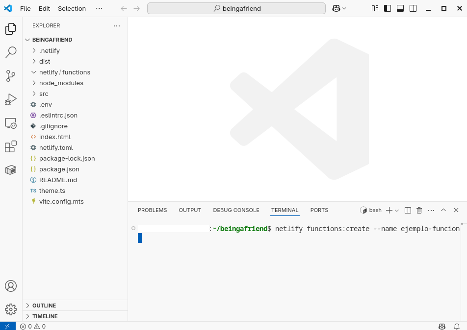

A continuación, elegir la opción "Serverless function (Node/Go/Rust)" usando las teclas de flecha y presionar ENTER:
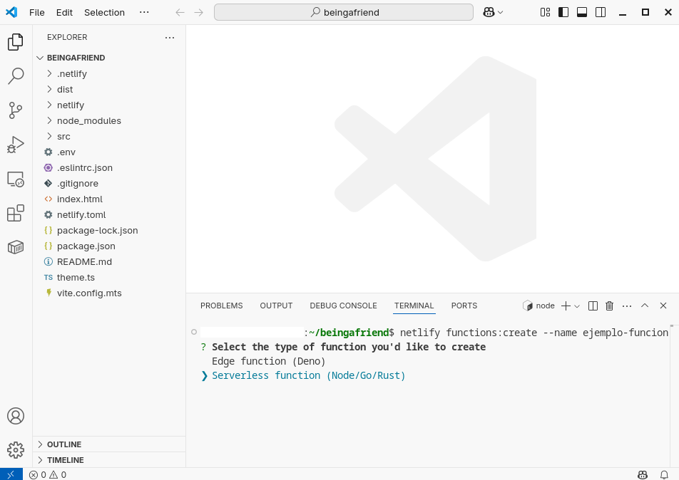

Elegir "TypeScript" como lenguaje de la función:
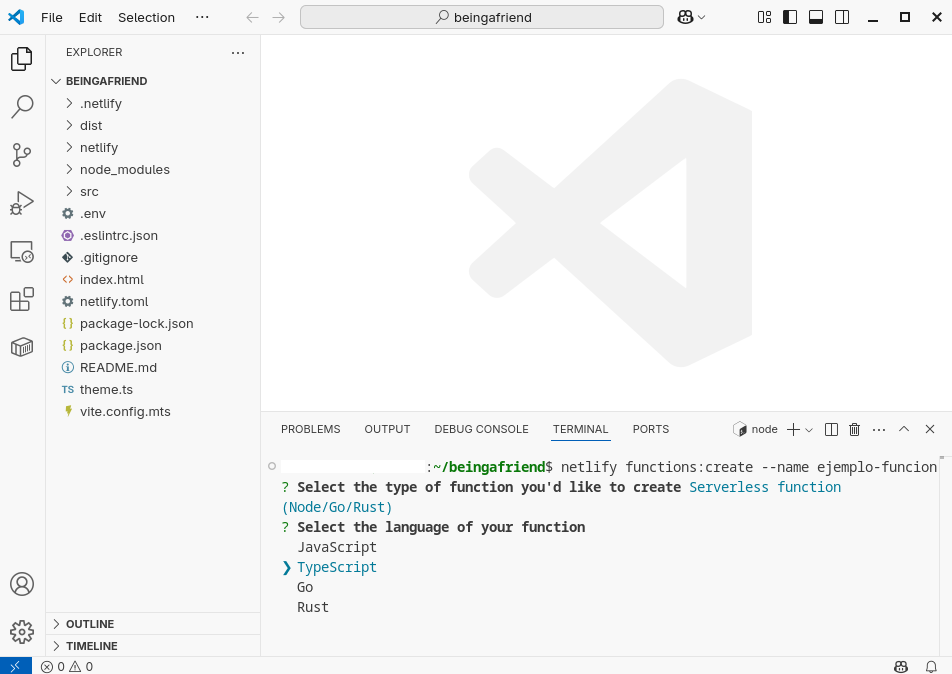

Elegir "[hello-world]" como plantilla de la función, usando las teclas de flecha y presionar ENTER:
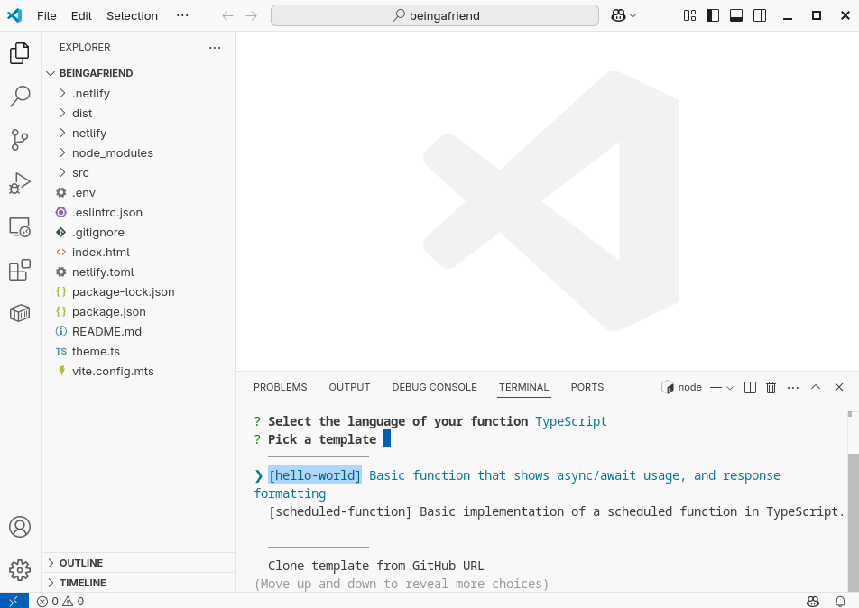

Esperar a que la creación de la función termine:
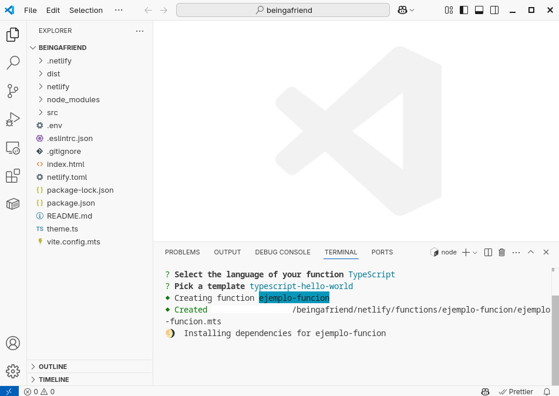
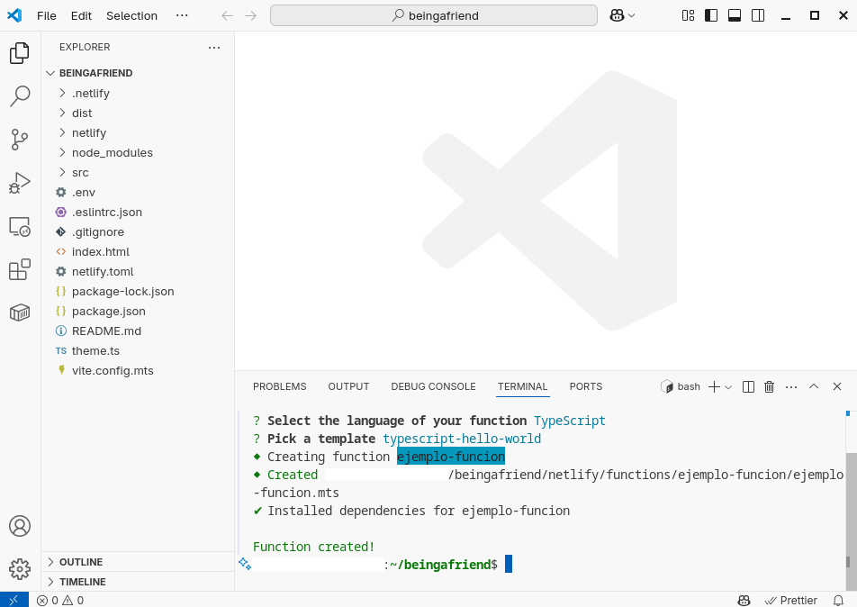

Como se muestra en la imagen de arriba, la función ha sido creada.

Luego, abrir el archivo de la función que se ha creado
en `netlify/functions/ejemplo-funcion/`, como se muestra en la siguiente imagen:
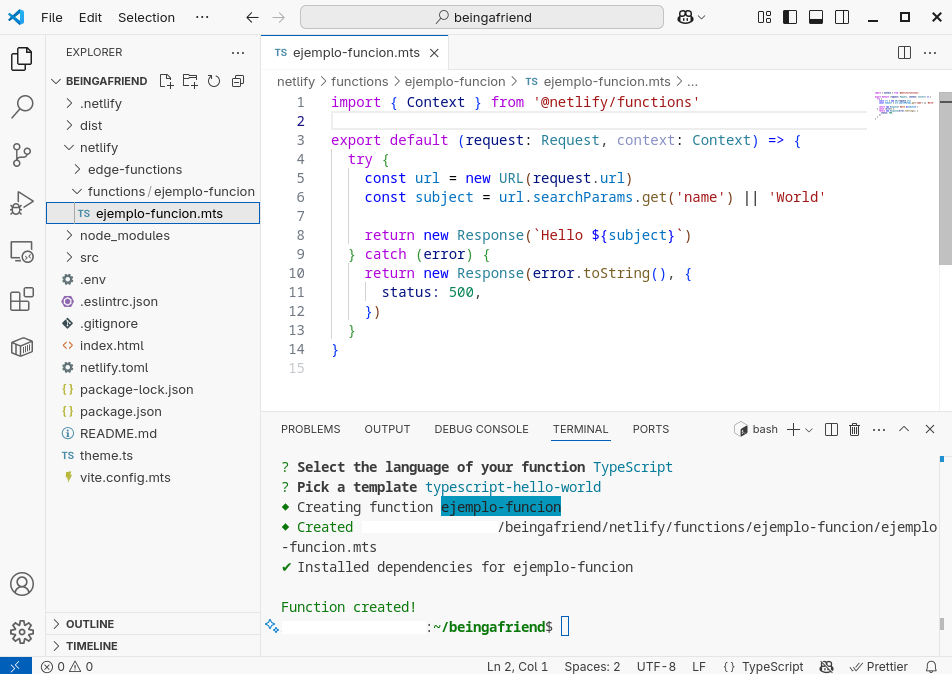

En la imagen de arriba, en el código de la función que se ha creado, se puede observar lo siguiente:

* La función recibe los parámetros `(request: Request, context: Context)`:
    * El parámetro `request` permite acceder a los datos de la petición del cliente que llama a esta función. Uno de estos datos podría ser una foto con un boceto de una interfaz de usuario (o formulario) que se quiere traducir a un diseño, mediante IA, que pueda ser editado en el software que se está desarrollando. (<a href="https://developer.mozilla.org/en-US/docs/Web/API/Request" target="_blank">Ver la documentación de la clase <code>Request</code></a>).
    * El parámetro `context` permite acceder a los datos relacionados con el cliente y con el backend, tales como: id del backend Netlify, cookies, información geográfica del cliente, ip del cliente, etc. (<a href="https://docs.netlify.com/functions/api/#netlify-specific-context-object" target="_blank">Ver la documentación del parámetro <code>context</code></a>)
* La función devuelve como respuesta un objeto de tipo `Response` (<a href="https://developer.mozilla.org/en-US/docs/Web/API/Response" target="_blank">Ver la documentación de la clase <code>Response</code></a>).
* La función es una <a href="https://docs.netlify.com/functions/get-started/?fn-language=ts#synchronous-function" target="_blank">función síncrona</a>. Esto significa que cuando el cliente llama a esta función permanece conectado en espera hasta recibir la respuesta de la función para luego, por ejemplo, mostrar una página o realizar otra tarea. (<a href="https://docs.netlify.com/functions/get-started/?fn-language=ts#synchronous-function" target="_blank">Ver más información sobre funciones síncronas en Netlify</a>)

## Para llamar a una función sin servidor

Para llamar a una función sin servidor de Netlify,
se debe saber que  
<a href="https://docs.netlify.com/functions/get-started/?fn-language=ts#route-requests" target="_blank">
Netlify crea automáticamente un endpoint para cada función
</a>, usando el formato:
`https://<YOUR-DOMAIN>/.netlify/functions/<FUNCTION-NAME>`

Es decir, que para llamar a la función `ejemplo-funcion`
desde el frontend, se puede hacer una petición de tipo `GET`
al endpoint `/.netlify/functions/ejemplo-funcion`

Para probar a llamar a la función sin servidor 
creada en el punto anterior, 
ejecutar primero el frontend 
mediante el siguiente comando:

```bash
netlify dev
```

como se muestra en la siguiente imagen:
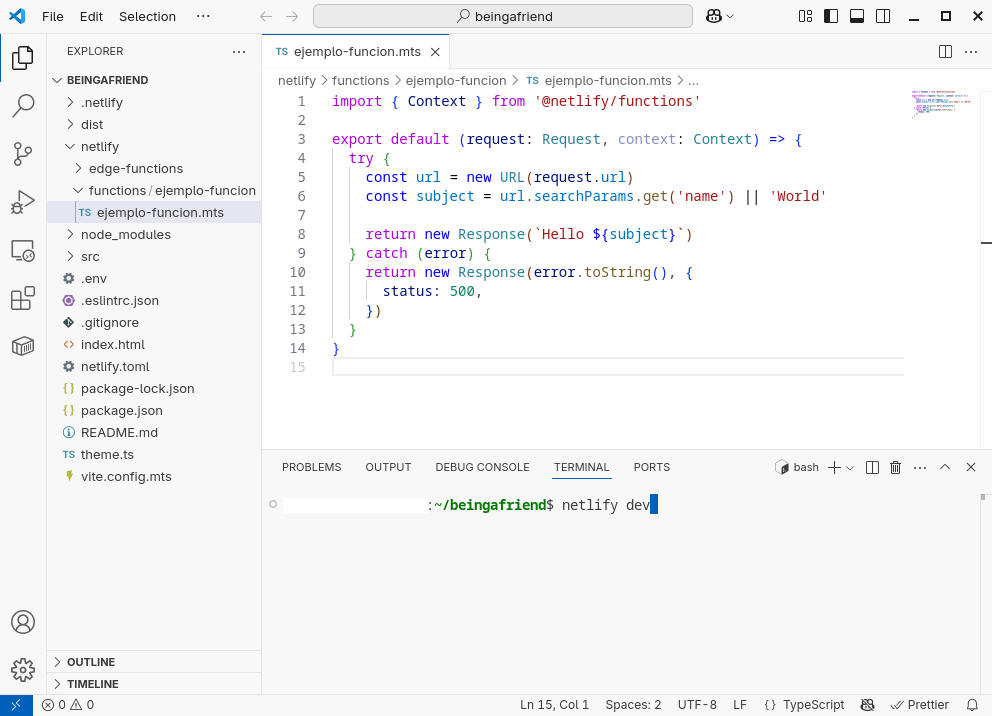


### Usando `fetch`

Se puede llamar a la función `ejemplo-funcion`
desde el frontend usando la <a href="https://developer.mozilla.org/es/docs/Web/API/Fetch_API/Using_Fetch" target="_blank">función <code>fetch</code> de JavaScript</a>.

Por ejemplo, usando el siguiente código:

```typescript
try {
    const response = await fetch("/.netlify/functions/ejemplo-funcion");
    if (!response.ok) {
        throw Error("No se pudo obtener una respuesta de la función.");
    }
    const data = await response.text();
    console.log(data);
} catch (e) {
    console.error(e);
}
```

Para ejecutar el código de arriba se puede usar el navegador web Google Chrome:

* Abriendo este enlace <a href="http://localhost:8888" target="_blank">http://localhost:8888</a> del frontend corriendo localmente
* Presionando F12 (estando en la página del frontend que se acaba de abrir)
* Pegando el código de arriba en la pestaña "Console" (que se mostró al presionar F12)
* Y presionando ENTER

como se muestra en la siguiente imagen:
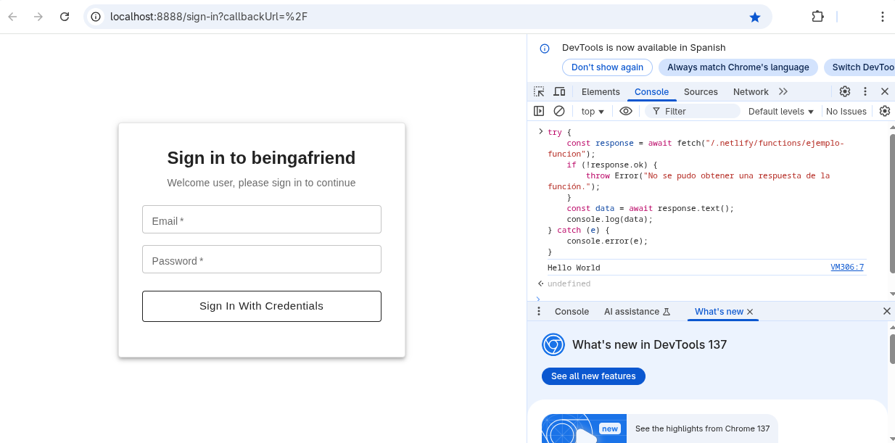
En la imagen de arriba, se puede ver que en la parte derecha
de la página (abierta presionando F12) se ha pegado el código en la pestaña "Console",
se ha ejecutado dicho código presionando ENTER, y se ha obtenido como 
respuesta el texto "Hello World".

De esta misma forma, se puede usar la <a href="https://developer.mozilla.org/es/docs/Web/API/Fetch_API/Using_Fetch" target="_blank">función <code>fetch</code> de JavaScript</a>
en cualquiera de las páginas del frontend.

### Usando cURL

Mientras se desarrolla el backend, también se puede llamar 
a una función sin servidor, como la función `ejemplo-funcion`,
usando <a href="https://curl.se/docs/tutorial.html" target="_blank">cURL</a>,
como se muestra a continuación:

```bash
curl -X GET "http://localhost:8888/.netlify/functions/ejemplo-funcion" -H "Accept: application/json"
```

```bash
curl -X GET "http://localhost:8888/.netlify/functions/ejemplo-funcion?name=Mundo" -H "Accept: application/json"
```

### Usando Postman

También se puede llamar a `ejemplo-funcion`
usando <a href="https://www.postman.com/" target="_blank">Postman</a>:

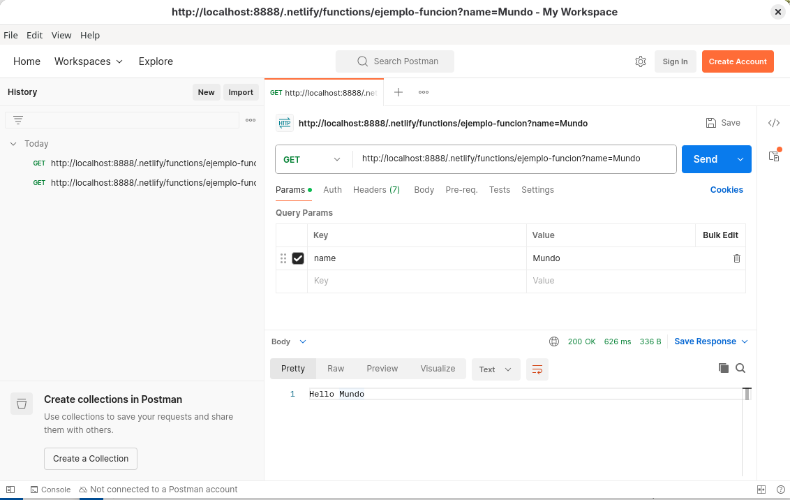

### Usando un navegador web

Otra forma de llamar a `ejemplo-funcion`
es abriendo su respectiva URL en un navegador web, como se muestra a continuación:

<a href="http://localhost:8888/.netlify/functions/ejemplo-funcion" target="_blank">
http://localhost:8888/.netlify/functions/ejemplo-funcion
</a>
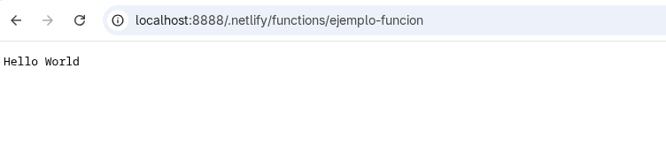

<a href="http://localhost:8888/.netlify/functions/ejemplo-funcion?name=Mundo" target="_blank">
http://localhost:8888/.netlify/functions/ejemplo-funcion?name=Mundo
</a>
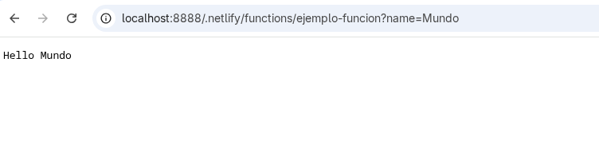

## Para implementar el backend

La lógica del backend se puede implementar casi completamente
usando funciones sin servidor que [pueden ser llamadas desde el frontend](#usando-fetch).

Para el 2do Parcial, lo que no podría implementarse
usando las funciones sin servidor es la parte colaborativa.
La parte colaborativa del 2do Parcial 
es la que permite que dos o más usuarios del software
puedan editar al mismo tiempo un mismo diseño de interfaces de usuario.

Para implementar la parte colaborativa del 2do Parcial
se puede aplicar la tecnología que se muestra en [la sección "Colaboración"](/tecnología/para-la-implementación/colaboración/).
