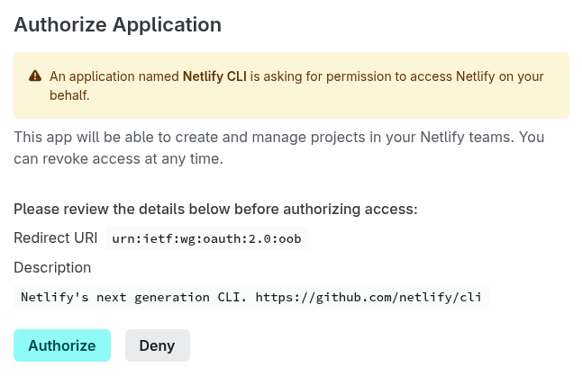
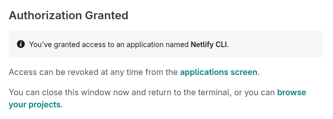

# Para instalar Netlify CLI

## Instalar

Para nstalar la herramienta
<a href="https://docs.netlify.com/cli/get-started/#installation" target="_blank">Netlify CLI</a>
ejecutar el siguiente comando:

```bash
npm install -g netlify-cli
```

## Iniciar sesión

Luego, iniciar sesión en Netlify CLI ejecutando el siguiente comando:

```bash
netlify login
```

Al ejecutar el comando anterior, se abrirá en el navegador web
la página que se muestra en la siguiente imagen.
Hacer clic en el botón "Authorize":


Y luego, cerrar la nueva página que se abre, cuya imagen se muestra a continuación:


¡Felicidades! 🥳🎉 ha instalado Netlify CLI correctamente.

Ahora puede continuar a [desplegar el frontend](../desplegar-el-frontend/).
