# Para aplicar Firebase Realtime Database

Para aplicar Firebase Realtime Database a su [proyecto inicial del frontend](/tecnología/para-la-implementación/frontend/toolpad/)
comience <a href="https://firebase.google.com/docs/database/web/start?hl=es-419#create_a_database" target="_blank">creando una base de datos</a>
siguiendo los pasos que se describen a continuación.

## Para crear la base de datos

Para crear la base de datos de Firebase Realtime Database
para su proyecto, abrir el siguiente enlace:

<a href="https://console.firebase.google.com/u/0/project/_/database?hl=es-419" target="_blank">
https://console.firebase.google.com/u/0/project/_/database?hl=es-419
</a>

En la página que aparece, como se muestra en la siguiente imagen,
hacer clic sobre el nombre de su proyecto (en este ejemplo,
este proyecto se llama "beingafriend"):
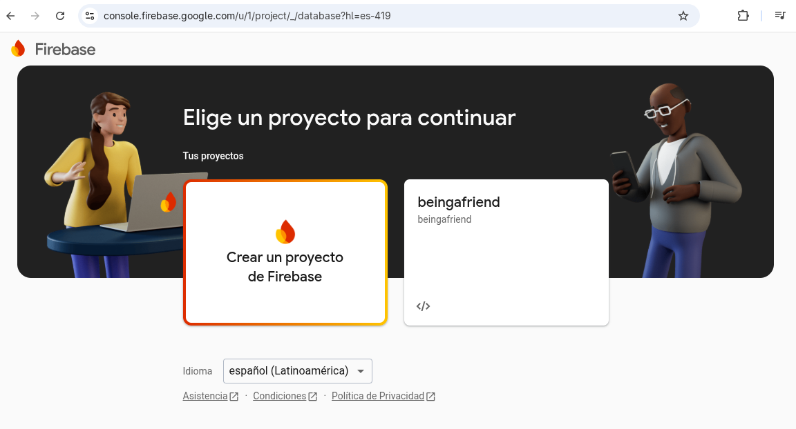

Luego, hacer clic en el botón "Crear una base de datos":
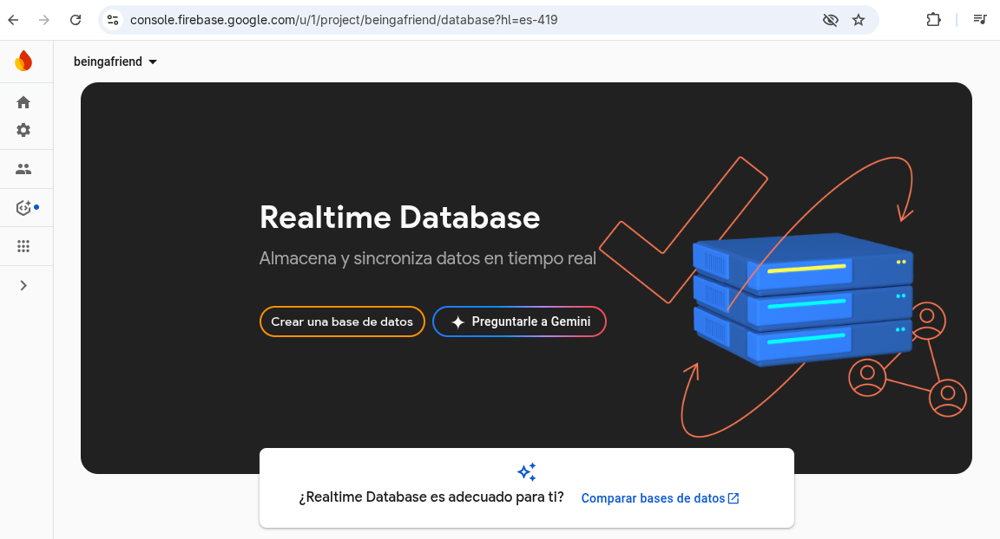

En el cuadro de diálogo que aparece, hacer clic en el botón
"Siguiente":
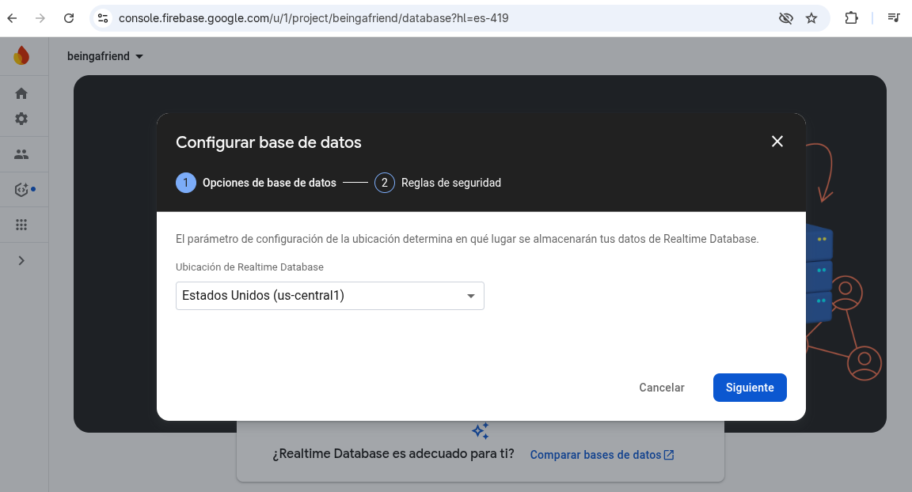

A continación, hacer clic en el botón "Habilitar":
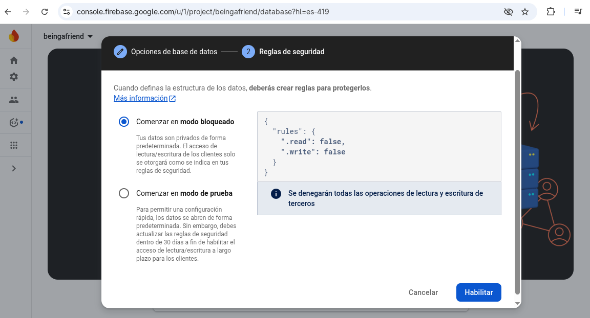

¡Felicidades! 🥳🎉 acaba de crear una base de datos en Firebase Realtime Database
para su proyecto inicial del frontend:
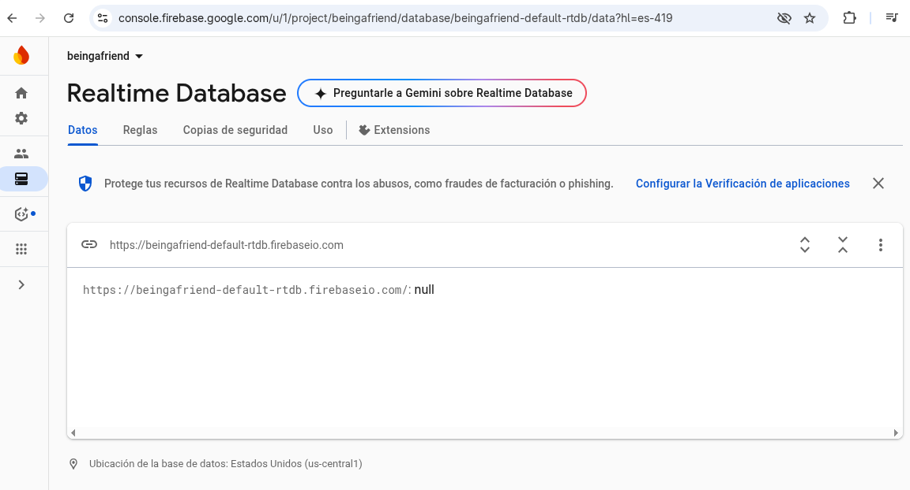

Continúe con los siguientes pasos 
[para definir las reglas de seguridad de su base datos](#para-definir-las-reglas-de-seguridad-de-la-base-datos).

## Para definir las reglas de seguridad de la base datos

En la página donde se quedó en el punto anterior,
hacer clic en la pestaña "Reglas":
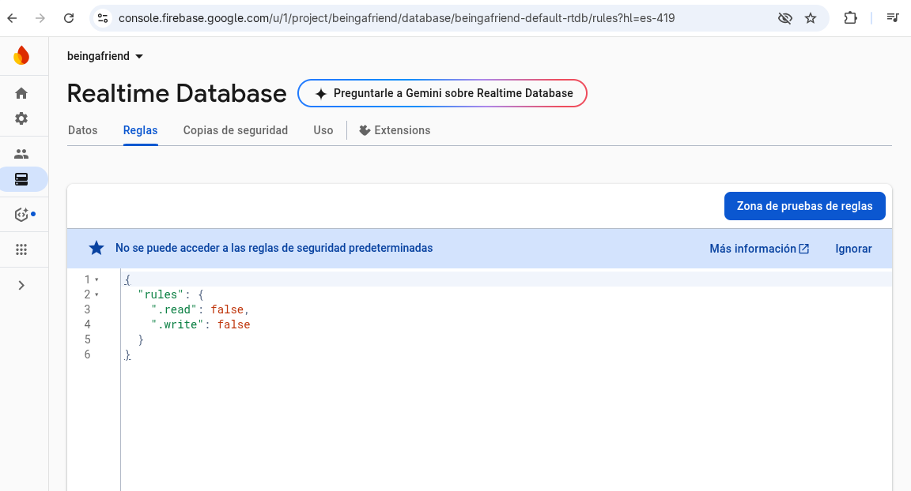

Observar que en la pestaña "Reglas" se muestra el siguiente código:
```json
{
  "rules": {
    ".read": false,
    ".write": false
  }
}
```

Reemplazar dicho código por el siguiente código:

```json
{
    "rules": {
        "$uid": {
            "texto": {
                ".read": "auth !== null && (auth.uid === $uid || root.child($uid).child('textoCompartidoCon').child(auth.token.email).exists())",
                ".write": "auth !== null && (auth.uid === $uid || root.child($uid).child('textoCompartidoCon').child(auth.token.email).exists())",
                ".validate": "newData.isString()"
            },
            "textoCompartidoCon": {
                "$emailUsuario": {
                    ".read": "auth !== null && auth.uid === $uid",
                    ".write": "auth !== null && auth.uid === $uid",
                    ".validate": "!newData.exists() || (newData.isBoolean() && newData.val() === true)"
                }
            }
        }
    }
}
```
como se muestra en la siguiente imagen:
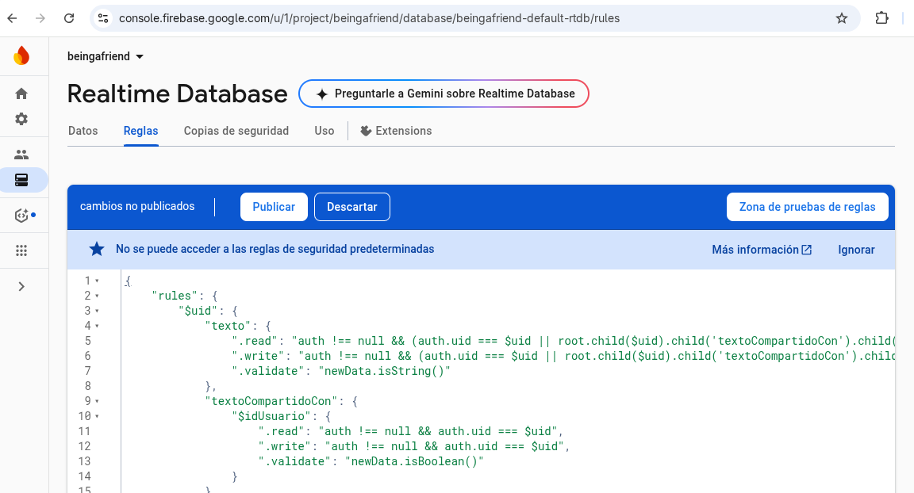
Y hacer clic en el botón "Publicar".

### Sobre las reglas de seguridad

Las reglas que estaban definidas inicialmente para la base de datos:
```json
{
  "rules": {
    ".read": false,
    ".write": false
  }
}
```
no permitían a los usuarios ni leer ni escribir en la base de datos.

Para definir las nuevas reglas,
se definió primero la siguiente base de datos de ejemplo:

```json
{
    "idUsuario1": {
        "texto": "<contenido del texto de idUsuario1>",
        "textoCompartidoCon": {
            "idUsuario2": true
        }
    },
    "idUsuario2": {
        "texto": "<contenido del texto de idUsuario2>",
        "textoCompartidoCon": {
        }
    },
    "idUsuario3": {
        "texto": "<contenido del texto de idUsuario3>",
        "textoCompartidoCon": {
        }
    }
}
```

En esta base de datos, los usuarios del software
pueden guardar un texto y compartirlo con otros usuarios
para editarlo colaborativamente con ellos. Observe que
una base de datos de Firebase Realtime Database
no es más que un documento JSON. (<a href="https://firebase.google.com/docs/database/web/structure-data?hl=es-419#how_data_is_structured_its_a_json_tree" target="_blank">Ver cómo se estructuran los datos</a>)

Las reglas de seguridad con las que se reemplazó a las reglas iniciales
de la base de datos, se definieron para ser aplicadas a esta base de datos de ejemplo.

A continuación, se muestra nuevamente estas reglas de seguridad:

```json
{
    "rules": {
        "$uid": {
            "texto": {
                ".read": "auth !== null && (auth.uid === $uid || root.child($uid).child('textoCompartidoCon').child(auth.uid).exists())",
                ".write": "auth !== null && (auth.uid === $uid || root.child($uid).child('textoCompartidoCon').child(auth.uid).exists())",
                ".validate": "newData.isString()"
            },
            "textoCompartidoCon": {
                "$idUsuario": {
                    ".read": "auth !== null && auth.uid === $uid",
                    ".write": "auth !== null && auth.uid === $uid",
                    ".validate": "!newData.exists() || (newData.isBoolean() && newData.val() === true)"
                }
            }
        }
    }
}
```

En ellas:

* `$uid` es una variable que al momento de evaluar las reglas
   toma el valor del nombre del atributo que corresponde a su mismo nivel
   en la base de datos. En la base de datos de ejemplo:
    * `$uid` puede tomar un valor del conjunto [`idUsuario1`, `idUsuario2`, `idUsuario3`].
* `.read`, `.write`, `.validate` permiten definir reglas 
  de lectura, escritura y validación, respectivamente, del atributo en el cual
  son definidos. En este ejemplo, el campo `texto` sólo puede se leído o escrito:
    * por un usuario que ha **iniciado sesión** en el software (`auth !== null`)
    + y que es **propietario** del campo `texto` (`auth.uid === $uid"`)
    * o que ha sido **compartido** con él (`root.child($uid).child('textoCompartidoCon').child(auth.uid).exists()`), es decir, que su `uid` existe en el campo `textoCompartidoCon`.
    * Además, se valida que el valor del campo `texto` 
      sea de tipo _string_ (`newData.isString()`).

Para conocer más sobre cómo definir las reglas de seguridad de la base de datos, consultar
la documentación oficial de Firebase Realtime Database abriendo los siguientes enlaces:

* <a href="https://firebase.google.com/docs/rules/basics?authuser=1&hl=es-419" target="_blank">Reglas de seguridad básicas</a>
* <a href="https://firebase.google.com/docs/database/security/core-syntax?authuser=1&hl=es-419" target="_blank">Conoce la sintaxis básica del lenguaje de reglas de seguridad de Realtime Database</a>
* <a href="https://firebase.google.com/docs/reference/security/database?authuser=1#rule_types" target="_blank">Firebase Database Security Rules API</a>

Para acceder a la base de datos desde el frontend,
seguir los pasos del [siguiente punto](#para-acceder-a-la-base-de-datos-desde-el-frontend).

## Para acceder a la base de datos desde el frontend

### Obtener la URL de la base de datos

Para acceder a la base de datos del frontend,
primero se debe obtener la URL de la base de datos. Para obtener esta URL,
abrir el siguiente enlace:

<a href="https://console.firebase.google.com/u/0/project/_/settings/general/web" target="_blank">
https://console.firebase.google.com/u/0/project/_/settings/general/web
</a>

Luego, en la página que se abre, hacer clic en el nombre
de su proyecto (en este ejemplo, el nombre del proyecto es "beingafriend"):
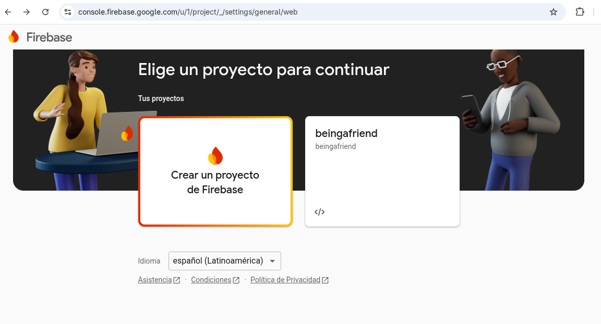

En la nueva página que se abre:
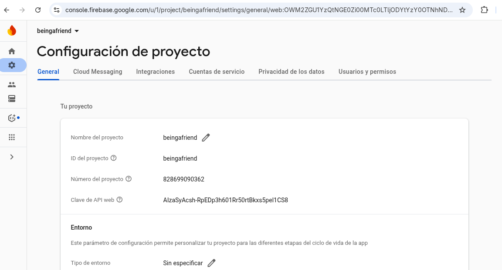

Desplazarse hacia abajo, hasta la sección "Tus apps" y
hacer clic en el botón con el símbolo "&lt;/&gt;" y que tiene a su lado
el nombre del proyecto (que en este ejemplo, es "beingafriend"),
como se muestra en la siguiente imagen:
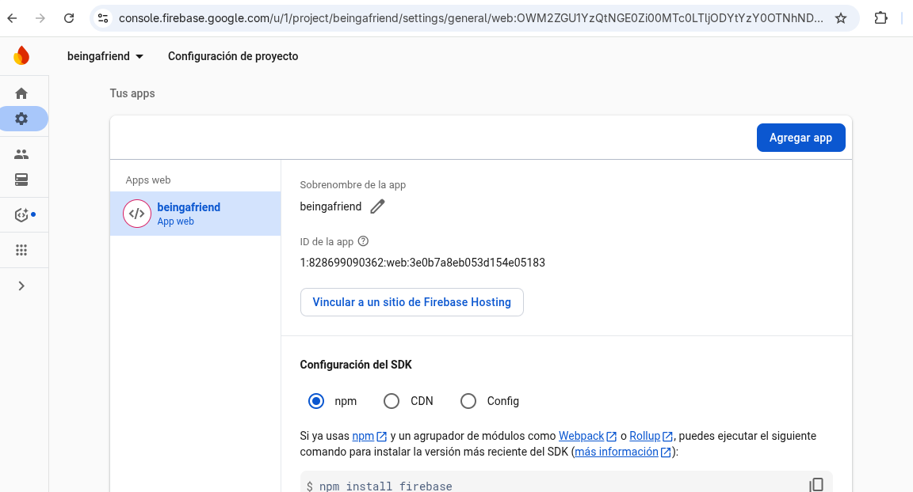

Después, en la subsección "Configuración del SDK",
hacer clic en la opción "Config",
como se muestra en la siguiente imagen:
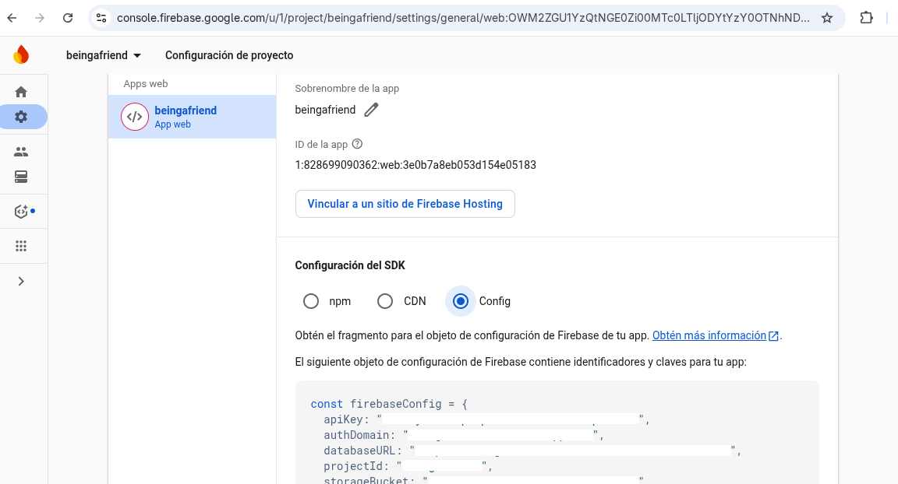
Observe en la imagen de arriba que la URL de la base de datos se muestra en el atributo
llamado `databaseURL` del código de `const firebaseConfig = {...`.

### Configurar el frontend para acceder a la base de datos

Copiar el valor de `databaseURL`, que se ha obtenido en el punto anterior, 
al archivo `.env`
del proyecto inicial del frontend, 
agregando a dicho archivo la siguiente línea:

```bash
VITE_FIREBASE_DATABASE_URL="<url de la base de datos>"
```
reemplazando `<url de la base de datos>` con el 
valor de `databaseURL` que se acaba de obtener,
como se muestra en la siguiente imagen:
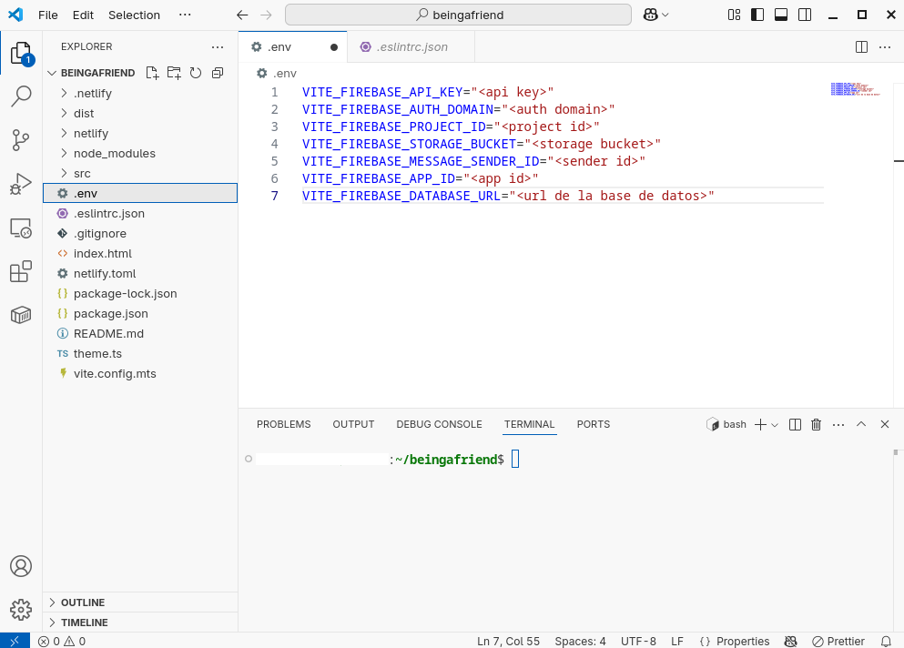

Guardar los cambios realizados al archivo `.env`.

Luego, abrir el archivo `src/firebase/firebaseConfig.ts`:
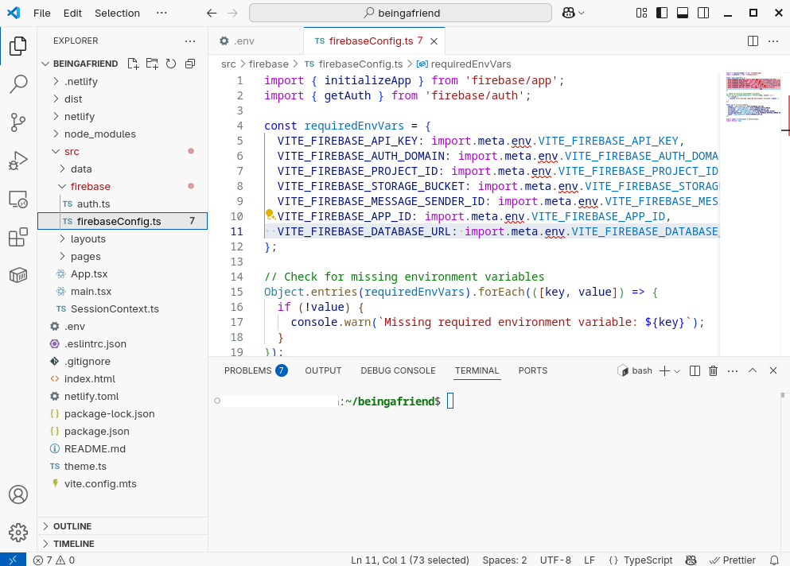
Y como se muestra en la imagen de arriba,
agregar la siguiente línea de código:
```typescript
VITE_FIREBASE_DATABASE_URL: import.meta.env.VITE_FIREBASE_DATABASE_URL,
```
abajo de la línea 10.

También, en el mismo archivo (`src/firebase/firebaseConfig.ts`),
agregar la siguiente línea de código:
```typescript
databaseURL: requiredEnvVars.VITE_FIREBASE_DATABASE_URL,
```
abajo de la línea 27, como se muestra en la siguiente imagen:
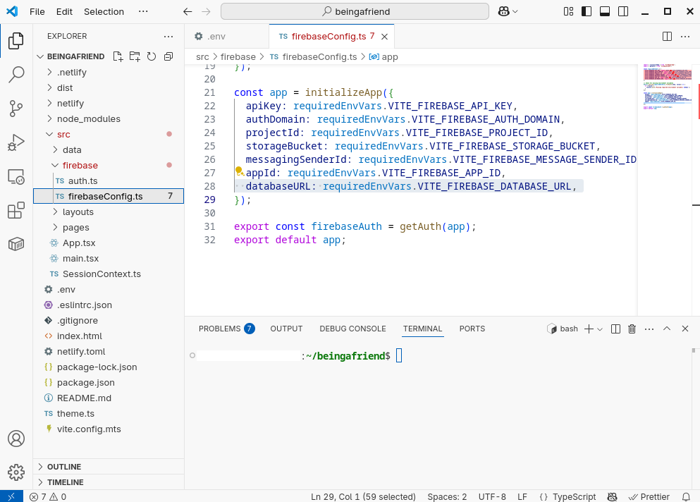

Luego, agregar la siguiente línea de código:
```typescript
export const firebaseDatabase = getDatabase(app);
```
abajo de la línea 31, como se muestra en la siguiente imagen:
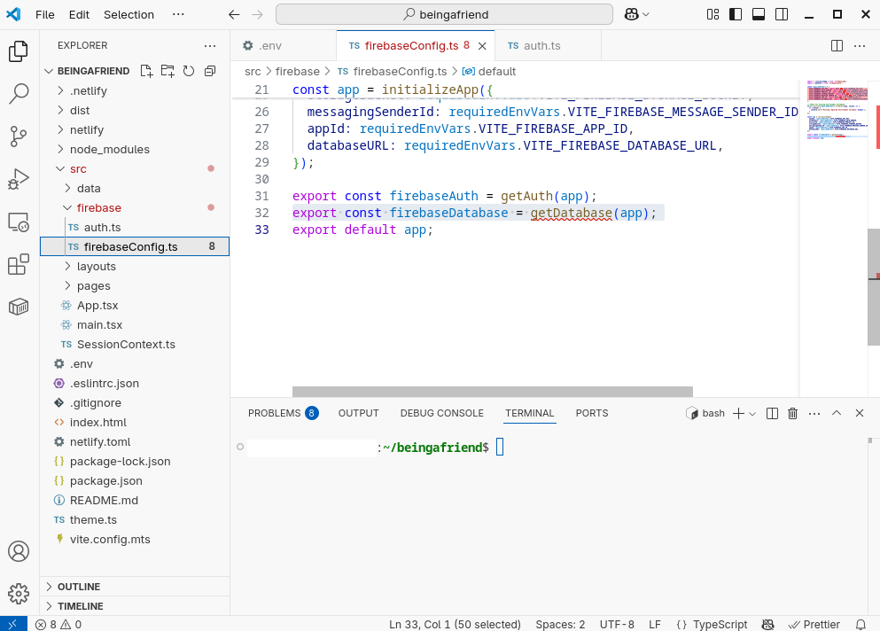


Y, finalmente, agregar la siguiente línea de código:
```typescript
import { getDatabase } from 'firebase/database';
```
abajo de la línea 2, como se muestra en la siguiente imagen:
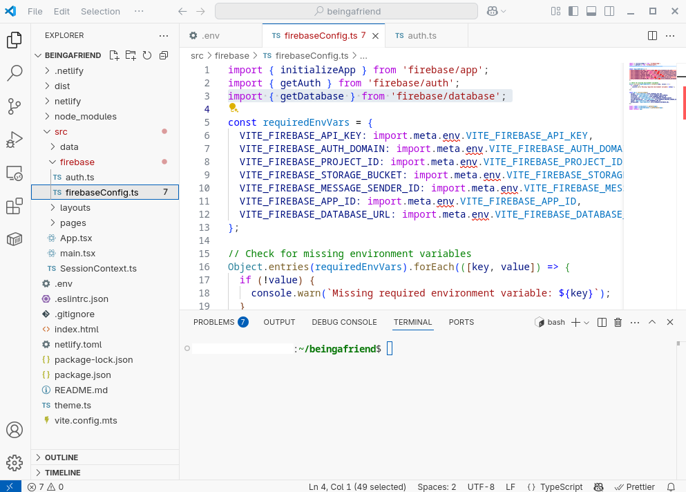

Guardar los cambios realizados.

### Implementar un editor de texto colaborativo

Seguir los siguientes pasos para aprender 
cómo aplicar Firebase Realtime Database
para implementar la parte colaborativa del 2do Parcial,
implementando primero un editor de texto colaborativo.

Abrir el proyecto del frontend inicial en Visual Studio Code.
Y luego, abrir el archivo `src/pages/index.tsx`,
como se muestra en la siguiente imagen:

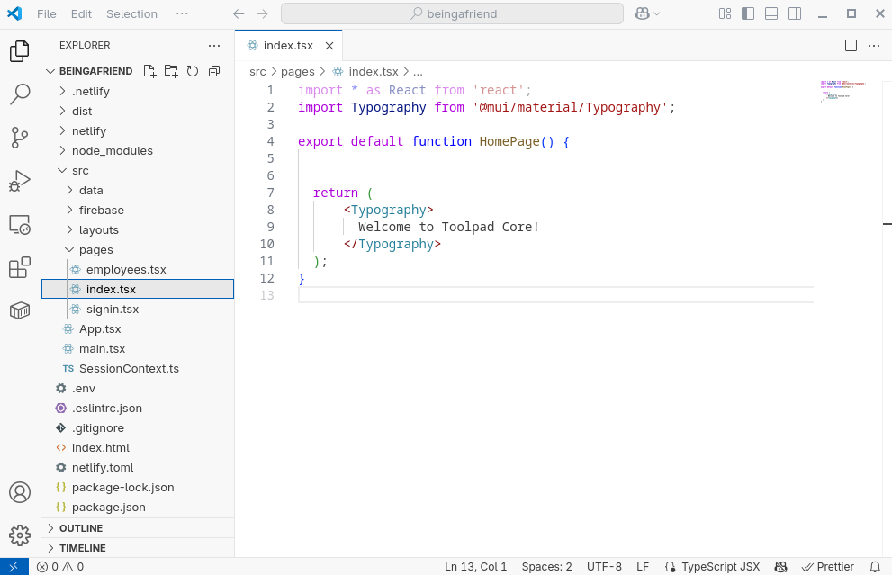

Abrir una terminal en Visual Studio Code (presionando CTRL+J)
y ejecutar el comando `netlify dev`
para correr localmente el frontend:

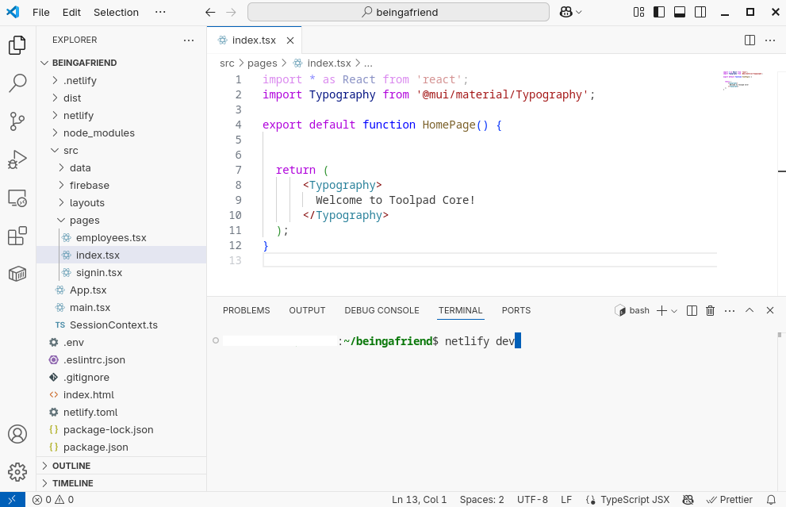

En la página que se abre, iniciar sesión
para ingresar:

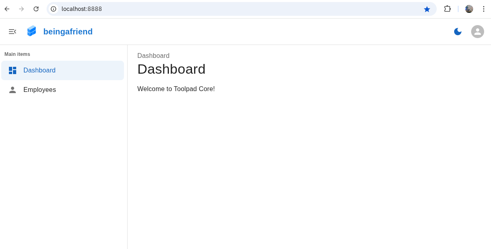

