# Para configurar la gestión de usuarios

Para configurar la gestión de usuarios en el proyecto que acaba de generar
en la [sección anterior](../toolpad)
seguir las siguientes instrucciones.

## Crear un proyecto en Google Cloud

Crear un proyecto en Google Cloud abriendo el siguiente enlace:

<a href="https://console.cloud.google.com/projectcreate" target="_blank">
https://console.cloud.google.com/projectcreate
</a>

Es posible que, antes de ver la página 
que se muestra en la siguiente imagen,
tenga que iniciar sesión con su correo electrónico de Gmail.

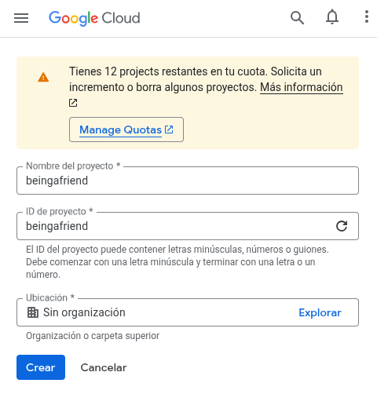

Como se muestra en la imagen anterior, ingresar el nombre del proyecto, 
el id del proyecto y hacer clic en el botón "Crear".

¡Felicidades! 🥳🎉 ha creado un proyecto en Google Cloud. Este proyecto
se utilizará en el siguiente punto.

## Crear un proyecto en Firebase

A continuación, crear un proyecto en Firebase abriendo el siguiente enlace:

<a href="https://console.firebase.google.com/" target="_blank">
https://console.firebase.google.com/
</a>

En la página que se muestra al abrir dicho enlace, hacer clic en "Comenzar con un proyecto de Firebase" (o "Crear un proyecto de Firebase"):

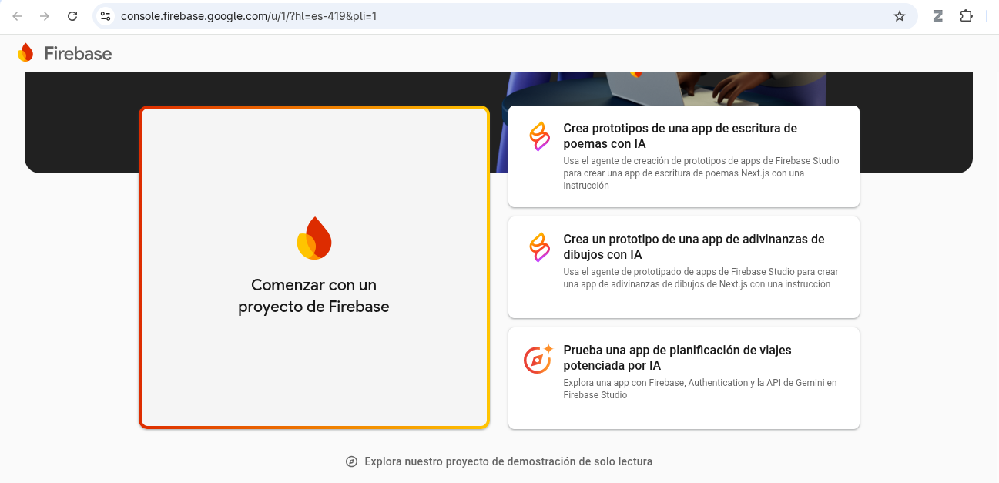

En la página que se abre, por el final de la página,
y sin ingresar ningún dato ni modificar nada, hacer clic en el enlace que dice 
"Agregar Firebase al proyecto de Google Cloud":

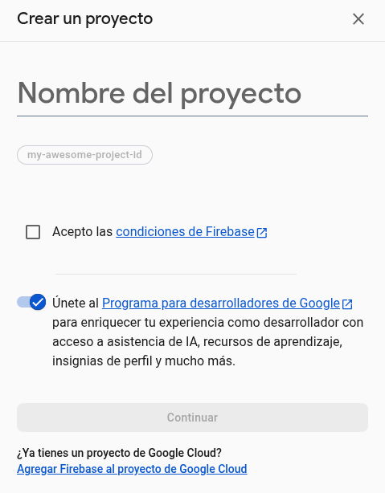

Luego, en la nueva página que se abre:

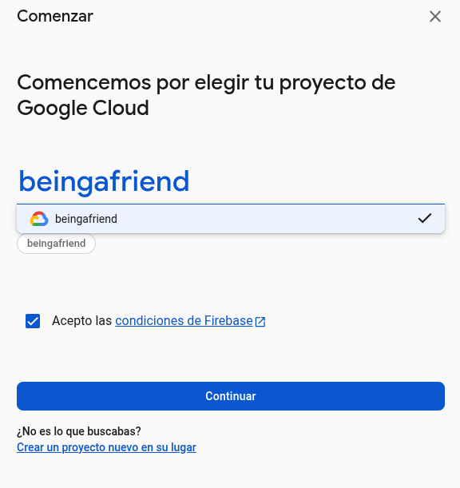

* seleccionar el nombre del proyecto de Google Cloud creado en el [punto anterior](#crear-un-proyecto-en-google-cloud)
(en este ejemplo, dicho proyecto se creó con el nombre: "beingafriend"),
* habilitar la casilla de verificación "Acepto las condiciones de Firebase"
* y hacer clic en el botón "Continuar".

En la página que se abre, también hacer clic en "Continuar":

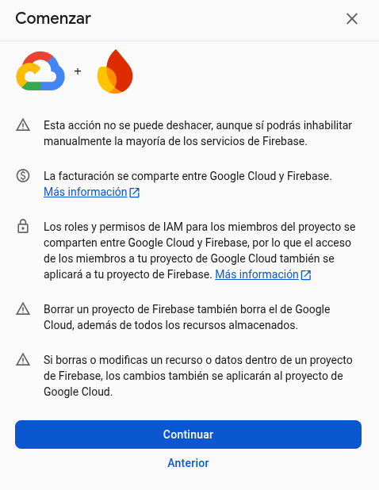

Deshabilitar la opción de Google Analytics para este proyecto
y hacer clic en el botón "Agregar Firebase":

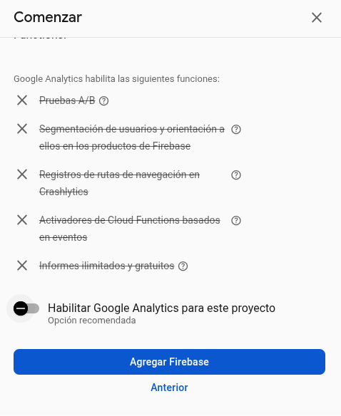

¡Felicidades! 🥳🎉 acaba de crear su proyecto en Firebase.


Hacer clic en "Continuar" para poder agregar usuarios
a su proyecto. Con estos usuarios podrá iniciar sesión
en el proyecto inicial del frontend generado en la [sección anterior](../toolpad).

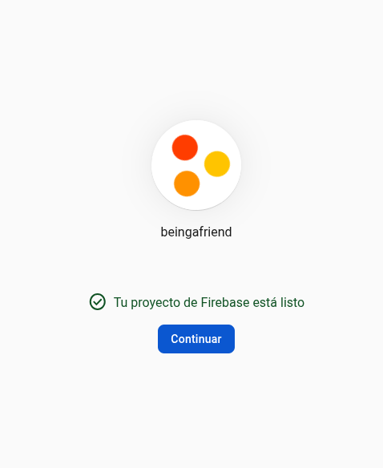

### Agregar usuarios

Continuando, en la página que aparece, hacer clic en "Authentication":

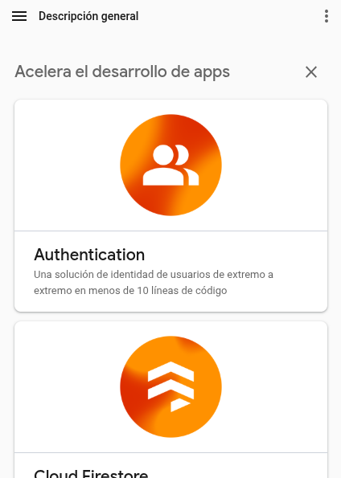

Luego, hacer clic en el botón "Comenzar":

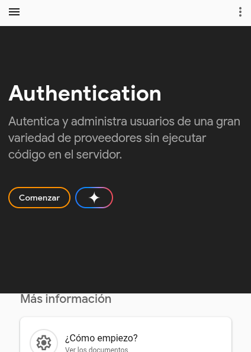

En la página que aparece, hacer clic en el botón "Correo electrónico":

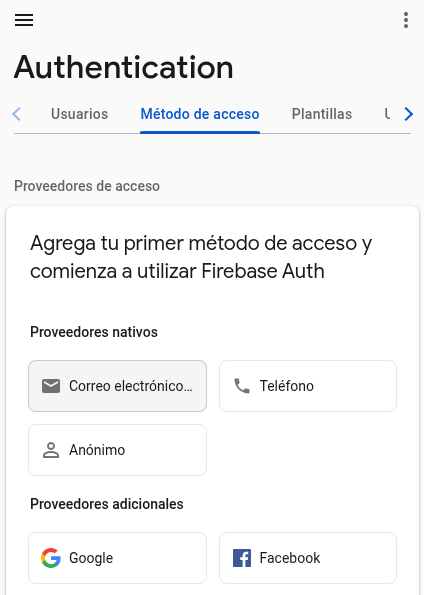

Habilitar la opción "Correo electrónico/contraseña" y hacer clic en el botón "Guardar":

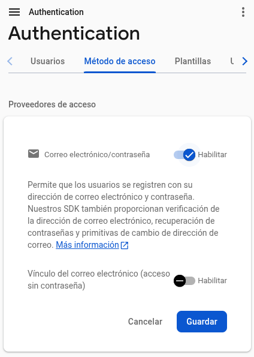

En la página que aparece, hacer clic en la pestaña "Usuarios":

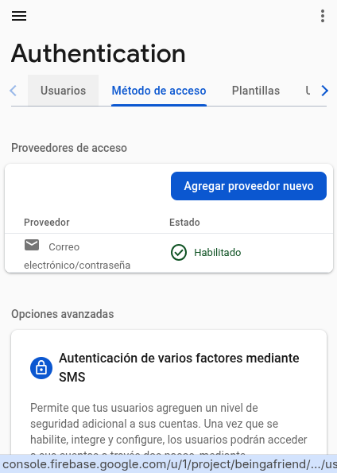

Luego, hacer clic en el botón "Agregar usuario":

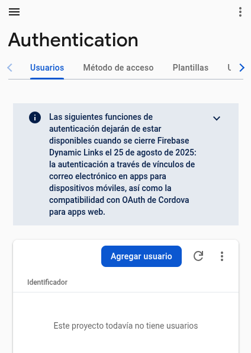

En el cuadro de diálogo que aparece, 
ingresar el correo electrónico y la contraseña
del nuevo usuario (no es necesario que el correo ingresado exista); 
y hacer clic en el botón "Agregar usuario":

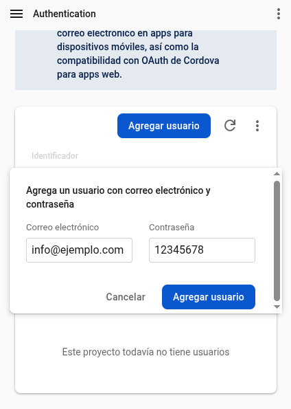


Agregar un segundo usuario:

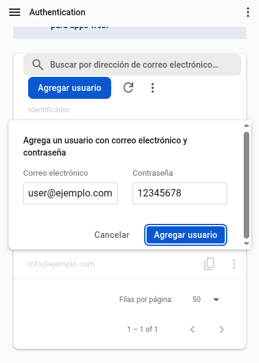


¡Felicidades! 🥳🎉 Ha agregado dos usuarios a su proyecto de Firebase:

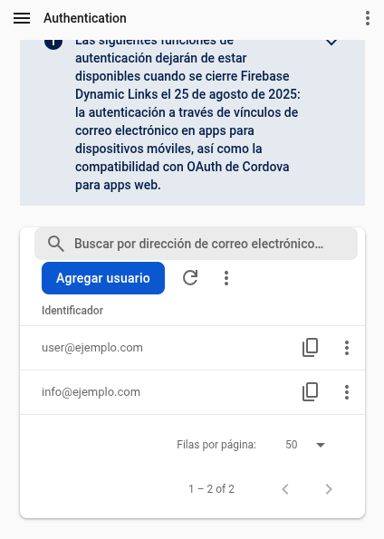

A continuación, debe obtener los datos de configuración de 
su proyecto de Firebase y agregarlos al proyecto inicial del frontend generado
en la [sección anterior](../toolpad).

### Obtener datos de configuración

En la página donde está actualmente,
abrir el menú lateral izquierdo de Firebase 
(si no está abierto ya)
haciendo clic en el botón con este ícono :material-menu::

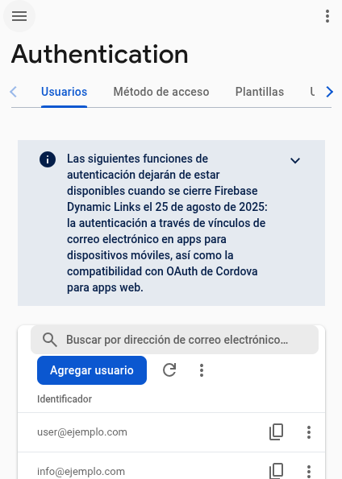

Luego, hacer clic en el ícono :fontawesome-solid-gear::

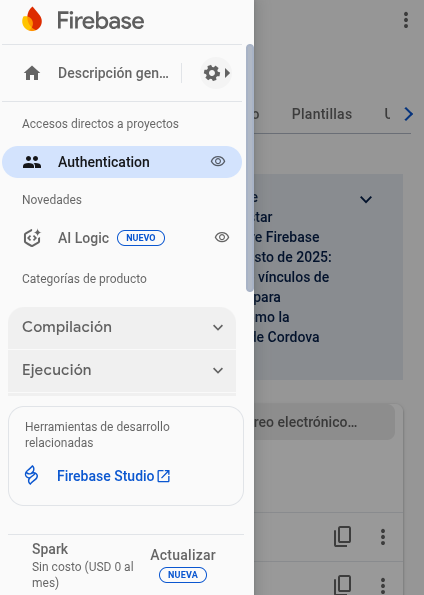

Hacer clic en "Configuración del proyecto":

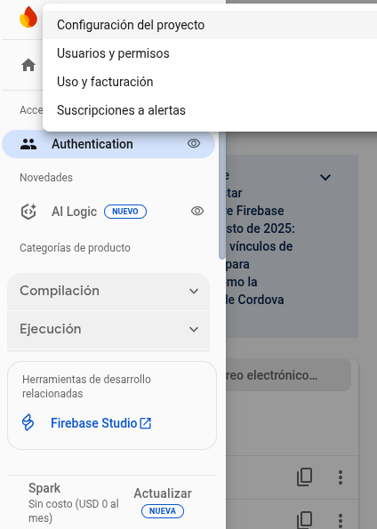

En la página que aparece, por el final de la página,
hacer clic en el botón que tiene un ícono con este símbolo "&lt;/&gt;":

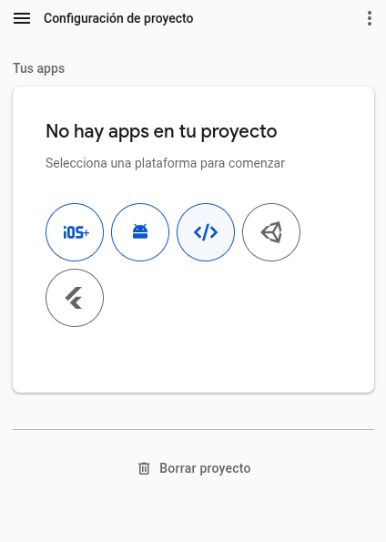

Luego, en la nueva página que aparece,
ingresar el nombre del proyecto inicial del frontend
generado en la [sección anterior](../toolpad)
(que en este ejemplo se llama "beingafriend")
y hacer clic en "Registrar app":

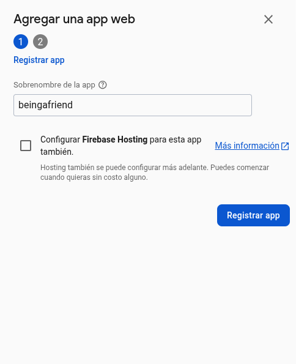

En la página que aparece, hacer clic en el botón "Ir a la consola":

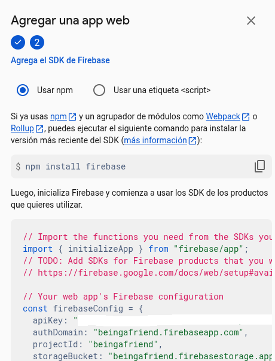

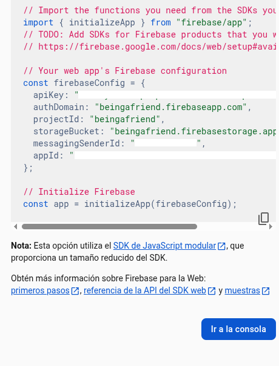

Luego, en la nueva página que aparece (que tiene como título: "Configuración del proyecto"), 
en la sección "Tus apps",
seleccionar la aplicación web que acaba de registrar
(que en este ejemplo se llama "beingafriend").


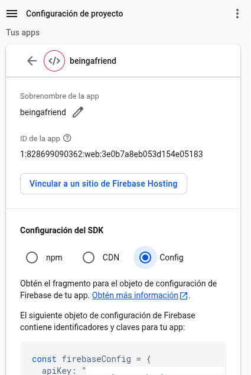

Y en esa misma página, en la subsección "Configuración del SDK",
haciendo clic en la opción "Config", 
puede obtener los datos de configuración de Firebase
(en la variable `const firebaseConfig = { ... }` del código
mostrado en dicha página).

## Agregar datos de configuración al proyecto inicial del frontend

Para agregar estos datos de configuración de Firebase
al proyecto inicial del frontend generado en la [sección anterior](../toolpad),
abrir dicho proyecto en Visual Studio Code.

Luego, abrir el archivo `.env`:

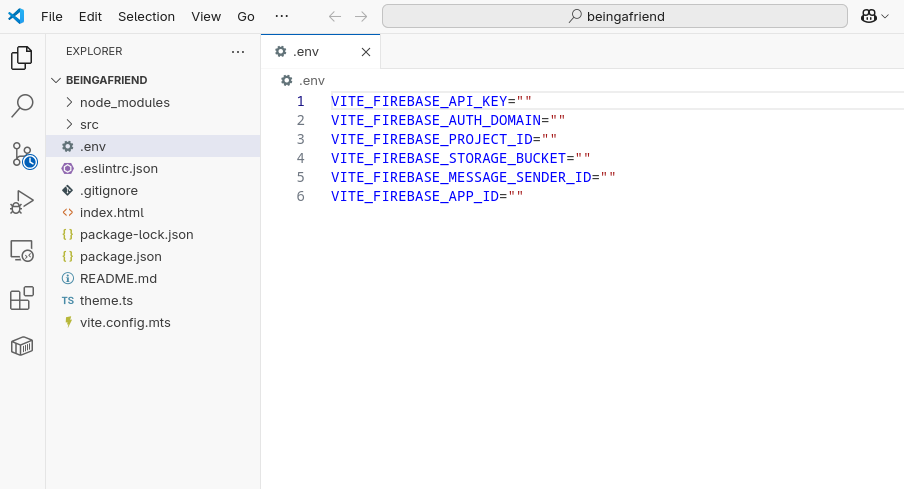

Y en este archivo `.env` ingresar los datos de configuración de Firebase que acaba de obtener en el [punto anterior](#obtener-datos-de-configuración).

A continuación, guardar el archivo `.env`.

## Probar la configuración del proyecto inicial del frontend

Antes de probar la configuración del proyecto inicial del frontend
generado en la [sección anterior](../toolpad),
realizar lo siguiente.

Abrir el archivo `src/layouts/dashboard.tsx` de dicho proyecto:

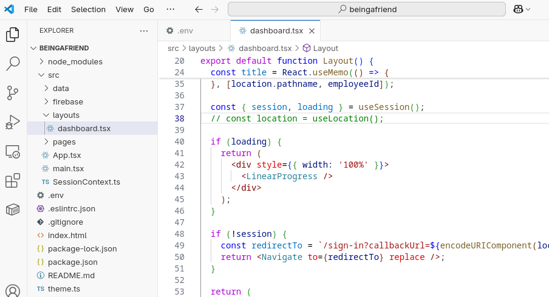

Y poner como comentario la línea 38 (`// const location = useLocation();`),
como se muestra en la imagen de arriba.

También, insertar el texto `, Navigate` en la línea 3 de dicho archivo, 
como se muestra en la siguiente imagen:

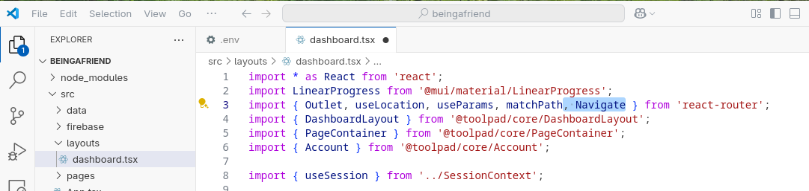

Guardar los cambios realizados.

Luego, abrir una ventana de terminal en Visual Studio Code
(presionando CTRL + J) 
y ejecutar el siguiente comando:

```bash
npm run dev
```

como se muestra a continuación:

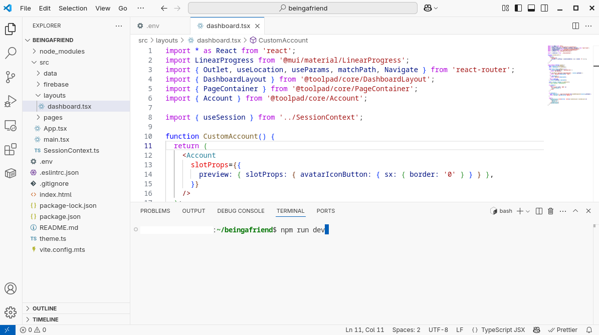

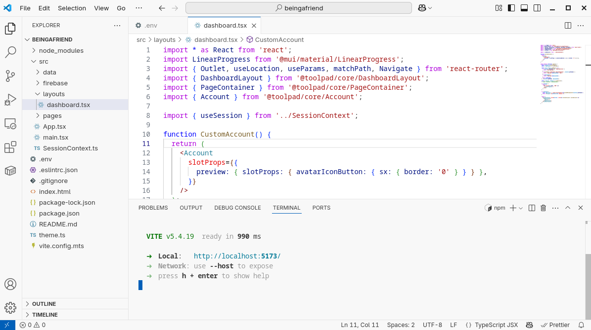

Abrir el enlace 
<a href="http://localhost:5173" target="_blank">
http://localhost:5173
</a>
y probar a iniciar sesión como uno de los dos usuarios [creados anteriormente](#agregar-usuarios):

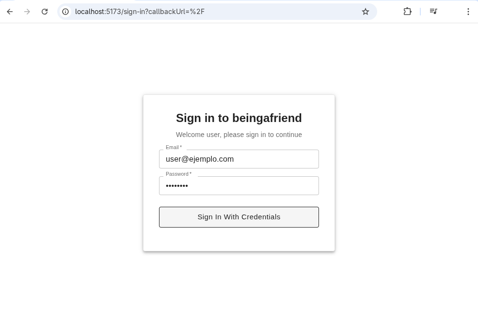

¡Felicidades! 🥳🎉 Ha configurado correctamente el proyecto inicial del frontend:

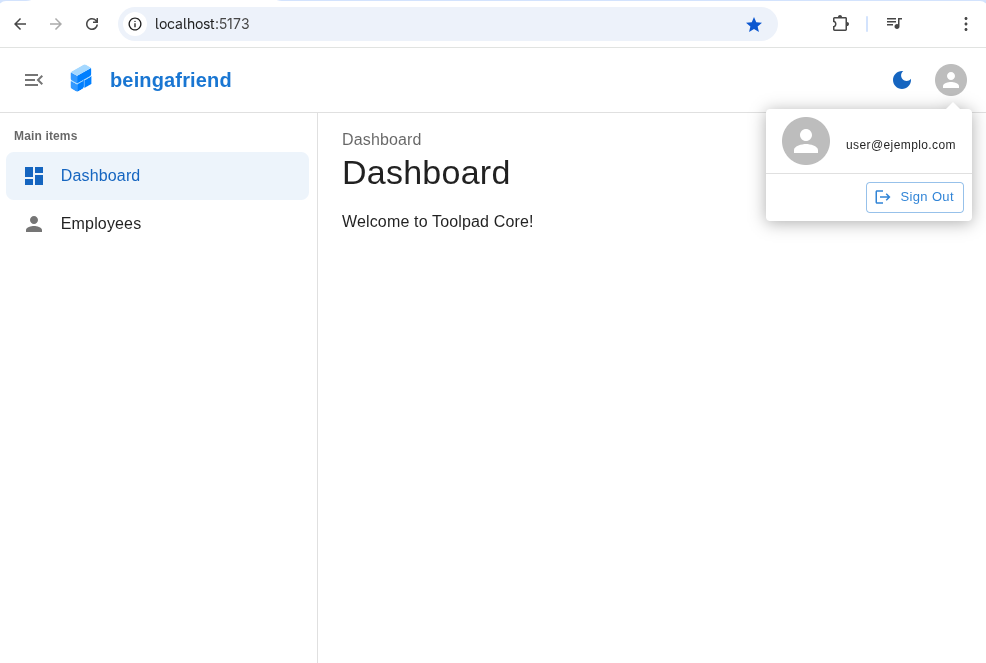

Ahora, puede continuar con la [implementación inicial del backend](../../backend).
