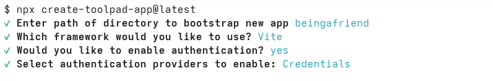

# Para generar el proyecto inicial del frontend

Para generar el proyecto inicial del frontend utilizando la plantilla 
<a href="https://mui.com/toolpad/core/introduction/" target="">Toolpad Core</a>
ejecutar el siguiente 
<a href="https://mui.com/toolpad/core/introduction/installation/#automatic-installation" target="_blank">comando</a>
:

```bash
npx create-toolpad-app@latest
```

ingresando los siguientes datos:

* Nombre del proyecto: **beingafriend** (elegir otro nombre)
* ¿Framework a usar? **Vite**
* ¿Habilitar autenticación? **Sí**
* Proveedor de autenticación habilitado: **Credentials** (usar la tecla ESPACIO para habilitar)

Tal como se muestra en la siguiente captura de pantalla:




El proyecto generado utiliza las siguientes tecnologías:

* Framework: <a href="https://es.react.dev/learn" target="_blank">React</a>
* Biblioteca de componentes: <a href="https://mui.com/material-ui/" target="_blank">Material UI</a>
* Herramienta de construcción (build tool): <a href="https://vite.dev/guide/" target="_blank">Vite</a>
* Gestión de usuarios: <a href="https://firebase.google.com/docs/auth?hl=es-419" target="_blank">Firebase Auth</a>

¡Felicidades! 🥳🎉 acaba de generar su proyecto inicial del frontend. 

Este proyecto le servirá como una estructura inicial sobre la cual podrá ir implementando la funcionalidad requerida por el 2do Parcial.

A continuación, debe [configurar la gestión de usuarios](../firebase) en el proyecto que acaba de generar.
