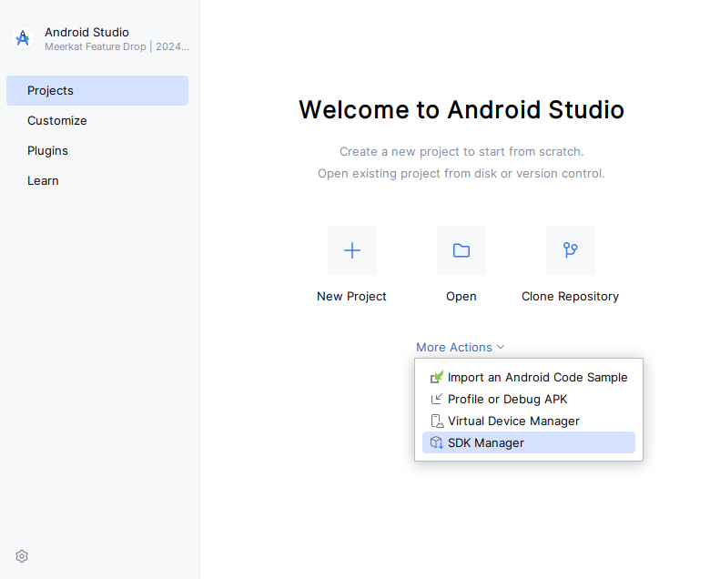
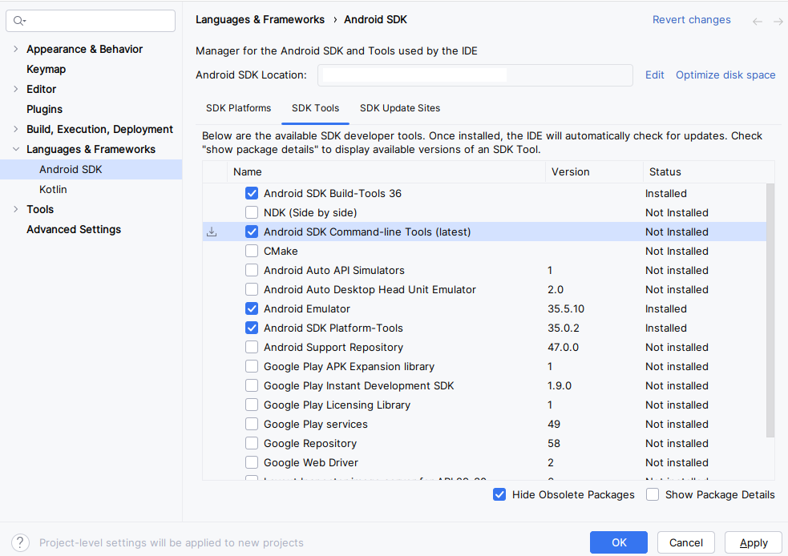
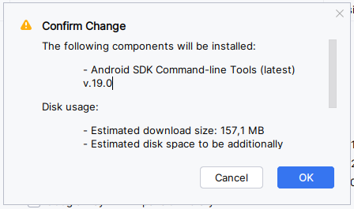
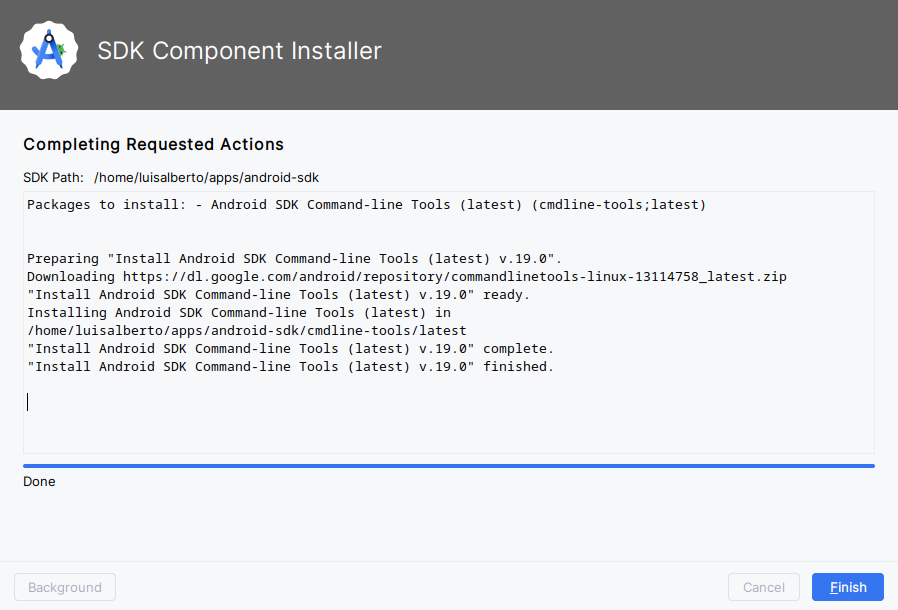
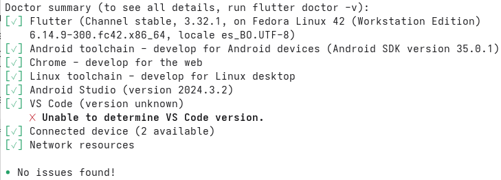

# Instalar primero

Para realizar la implementación del 2do Parcial,
es necesario tener instaladas las siguientes
herramientas.

## Git

1. Descargar el instalador de <a href="https://gitforwindows.org/" target="_blank">Git para Windows</a> abriendo el siguiente enlace: <a href="https://github.com/git-for-windows/git/releases/download/v2.49.0.windows.1/Git-2.49.0-64-bit.exe" target="_blank">https://github.com/git-for-windows/git/releases/download/v2.49.0.windows.1/Git-2.49.0-64-bit.exe</a>
2. Ejecutar el instalador que se ha descargado.
3. Seguir los pasos que le va indicando el instalador hasta completar la instalación.

## Node

1. Descargar el instalador de <a href="https://nodejs.org/es" target="_blank">Node</a> para Windows abriendo el siguiente enlace: <a href="https://nodejs.org/dist/v22.16.0/node-v22.16.0-x64.msi" target="_blank">https://nodejs.org/dist/v22.16.0/node-v22.16.0-x64.msi</a>
2. Ejecutar el instalador que se ha descargado.
3. Seguir los pasos que le va indicando el instalador hasta completar la instalación.

## Android Studio

1. Descargar el instalador de <a href="https://developer.android.com/studio" target="_blank">Android Studio</a> para Windows abriendo el siguiente enlace: <a href="https://redirector.gvt1.com/edgedl/android/studio/install/2024.3.2.15/android-studio-2024.3.2.15-windows.exe" target="_blank">https://redirector.gvt1.com/edgedl/android/studio/install/2024.3.2.15/android-studio-2024.3.2.15-windows.exe</a>
2. Ejecutar el instalador que se ha descargado.
3. Seguir los pasos que le va indicando el instalador hasta completar la instalación.

### Instalar Android SDK Command-line Tools

Para instalar Android SDK Command-line Tools, 
primero ejecutar Android Studio.

Luego, en la ventana que aparece, hacer clic en "More Actions" > "SDK Manager",
como se muestra en la siguiente imagen:



En la nueva ventana que aparece, en la pestaña "SDK Tools", 
marcar la opción "Android SDK Command-line Tools (latest)"
y hacer clic en el botón "OK".



Confirmar los cambios haciendo clic en "OK":



Esperar a que la instalación termine y luego hacer clic en "Finish":




## Visual Studio Code

1. Descargar el instalador de <a href="https://code.visualstudio.com/" target="_blank">Visual Studio Code</a> para Windows abriendo el siguiente enlace: <a href="https://code.visualstudio.com/sha/download?build=stable&os=win32-x64-user" target="_blank">https://code.visualstudio.com/sha/download?build=stable&os=win32-x64-user</a>
2. Ejecutar el instalador que se ha descargado.
3. Seguir los pasos que le va indicando el instalador hasta completar la instalación.


## Flutter

Descargar y descomprimir <a href="https://flutter.dev/" target="_blank">Flutter</a> para Windows abriendo el siguiente enlace:

<a href="https://storage.googleapis.com/flutter_infra_release/releases/stable/windows/flutter_windows_3.32.1-stable.zip" target="_blank">
https://storage.googleapis.com/flutter_infra_release/releases/stable/windows/flutter_windows_3.32.1-stable.zip
</a>

Abrir la carpeta creada al descomprimir. Y en adelante, reemplazar el texto `FLUTTER_DIR` por la ruta completa a dicha carpeta, la cual contiene directamente carpetas como: `bin` y `cache`.

Eliminar la carpeta `FLUTTER_DIR/bin/cache` 
(Seleccionado la carpeta `cache` en el Explorador de archivos y presionando SHIFT+SUPRIMIR).

Agregar la ruta de la carpeta `FLUTTER_DIR/bin` a la variable de entorno `PATH` del sistema operativo (Este video <a href="https://www.youtube.com/watch?v=yHR6PRbW9tc" target="_blank">https://www.youtube.com/watch?v=yHR6PRbW9tc</a> explica detalladamente sobre las variables de entorno en Windows y sobre cómo modificar la variable PATH. Para buscar en YouTube otros videos sobre el mismo tema puede <a href="https://www.youtube.com/results?search_query=windows+configurar+variable+path" target="_blank">hacer clic aquí</a>).

Luego, aceptar las licencias de Android ejecutando el siguiente comando:

```bash
flutter doctor --android-licenses
```

Finalmente, ejecutar el comando:

```bash
flutter doctor
```

Verificar que la línea final de la salida del anterior comando dice "No issues found!",
como se muestra en la siguiente imagen:



La misma salida del anterior comando indica cuáles acciones realizar
para corregir los errores que se hubieran encontrado. Entonces:

* realizar la primera de dichas acciones,
* y luego, volver a ejecutar `flutter doctor`
* repetir estos dos últimos pasos hasta que la línea final de la salida del comando diga "No issues found!".

Una vez instalado Flutter, puede [continuar con la implementación inicial del frontend](../frontend).
